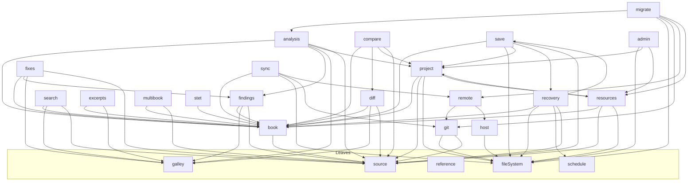

# Services at a glance

One section per service: what it is in plain words, what is wrong or constrained about it today, and where it could go. Depth lives in [`architecture/`](architecture/); each section links to its chapter. This page replaces the v2 module DAG and the slice plans that lived in the old planning folders. The graph below was redrawn from real `src/core` imports on 2026-09-23.

**Keep it short.** A section that grows past a screen is a sign its detail belongs in the architecture chapter. When an item is fixed, delete it; when an idea gets serious, give it an item in `planning/items/` (status `discussing`) and leave a one-line pointer here.

## Where to focus (as of 2026-09-25)

1. **Location** — done: every place question goes through Citation, Address and Location over the engine's TOC, and no regex reads a designator. Anchors (for comments) are the next piece, when comments start. See [Location](#location-and-reference) and [the Location chapter](architecture/location.md).
2. **Git, top to bottom** — the lifecycle pass is built on the `git-lifecycle` branch (2026-09-30): one writer per repository, receive as a fast-forward through the Books, Combine as a decision commit, intake, check on open and send on save. History time travel is next. See [Git](#git).
3. **One diff and sync model** — after the primitives settle: stop reading every book (the line diff is retired, 2026-09-27), one change classification for History, Review and Cloud. See [Diff](#diff) and the retired Git lifecycle spec (`git log -- planning/01-discussing/diff-and-sync-model-2026-09-23.md`).
4. **Data safety in Recovery** — done on the review branch (2026-09-28): a journal knows the text it started from by hash, and one subscriber on the canonical edit feed backs up every book. What is left is a damaged journal's valid prefix, and a recovery unit test (a candidate in the testing chapter). See [Recovery](#recovery).

## The graph

Arrows point at what a module imports. Every module also emits to Observability; that edge is omitted.

Above core: `packages/editor` (CodeMirror; Book → EditorBook, the funnel, recipes) and `src/platform/{web,tauri,node}` (one Layer per host capability). Above those sits `src/app` (composition, commands, ProjectContext, stores, workflows, UI) with `src/routes`. `src/dev` is the design surface and never ships. [Boundaries](architecture/boundaries.md) is the enforced version of this.

Save ↔ Recovery is one two-way pair: recovery reads the Baseline type, and save optionally asks for Recovery to clear a journal. Resources ↔ Project is the other: the Library describes a folder through `discovery.ts`'s `readProjectMetadata` (so a Resource Container's `manifest.yaml` names it), and discovery decodes through the resources schemas. No file imports back into itself; `pnpm deadcode` checks the cycles.

---

# Host

## HostInfo

### Overview

Tells the app which host it is on (Web or Tauri), the build identity, the locale, the app paths (appData, logs, journal) and a capability set (`nativeDisk`, `nativeGit`, `fsWatch`, `dialogs`, `secureStore`). `src/core/host/hostInfo.ts`, one implementation per host in `src/platform`. → [host](architecture/host.md)

### Constraints and known bugs

- None known.

### Ideas / future

- None.

## FileSystem

### Overview

The port is `effect/FileSystem` used as-is. Implementations: memory (tests, fixture), Node (tooling), OPFS (Web), Tauri fs plugin (desktop, the only one with a real `watch`). `writeFileAtomic`, `scopedTo` and a 17-law contract suite live in `src/core/fileSystem`. `nodeView` is the Node-shaped `fs` that isomorphic-git reads through. On the Web OPFS pays per file (about 1 ms on a clean machine, 6–9 ms under an on-access scanner like the one on WA's Macs), so many-file work is staged in memory and written once, as few files as possible ("The OPFS tax"). → [storage](architecture/storage.md)

### Constraints and known bugs

- Web cannot open a folder on the user's disk: `pickFolder` returns a handle name, not a path (`TODO(seam)` in `platform/web/dialogs.ts`).
- Web never calls `navigator.storage.persist()`, and nothing tells the user if the browser evicts storage.
- The Tauri implementation is not run against the contract suite (it needs a Tauri runtime). Its `copy` was unimplemented until 2026-10-12, which failed every Import folder on desktop; driving the app found it, and `pnpm test:desktop` now imports a folder through it.
- On desktop every file call is one IPC round trip, so work that touches thousands of files one at a time is slow there however fast the disk is. Two such walks were found and fixed on 2026-10-13: Translation Notes' freshness check and first read (one `stat` and one read per file; now one call each through the `FolderTree` service, `tree_listing` and `tree_read`), and finding the recovery journals (a recursive listing of all of app data; journals now have their own folder). Anything else that walks a big tree file by file through the port pays the same.
- The two desktop tree commands read with `std::fs`, outside the fs plugin's scope; since 2026-10-13 they answer only below the canonical app data folder and never follow a symlink (driven: `/etc`, the scratch home, a `..` path, a read through a link to `/etc` and a link loop are refused or skipped). Desktop's recursive `copy` skips symlinks too, and takes each entry's kind from `readDir`.

### Ideas / future

- A Tauri journey that proves real IPC and a refusal outside the fs scope. The harness exists (`pnpm test:desktop`, `e2e-desktop/`); the journey does not.

## Settings

### Overview

Schema-validated preferences persisted as JSON through `writeFileAtomic`. Each module registers its own keys and gets a token back; a bad value falls back to its default. Writes go one at a time (a one-permit `Semaphore` across snapshot, save and publish): overlapping `set`s used to each save a file missing the other's key, and opening a project — three keys at once — lost its slug, so a reload found no project. `src/core/host/settings.ts`, `src/app/settings.ts`, the `/project/$slug/settings` route (`/settings` redirects to `/projects`). → [host](architecture/host.md), [shell](architecture/shell.md)

### Constraints and known bugs

- The proofreading (Sous) settings are one global key, `sous.settings`, holding only what the reader changed from kitchen's defaults (`src/app/sousSettings.ts`); they are not per project.

### Ideas / future

- Git author name and email as a setting (see [Git](#git)).

## Credentials

### Overview

Tokens for remotes, never in project files. Web keeps them in `localStorage` keyed by endpoint origin; desktop keeps them in the OS keychain through Rust commands. The consumer is the Gitea account code. → [host](architecture/host.md), [git](architecture/git.md)

### Constraints and known bugs

- Desktop: the keychain `service` name comes from the webview rather than being fixed in Rust.

### Ideas / future

- None.

## Dialogs

### Overview

Open, save and folder pickers behind one port, with Web and Tauri implementations. `src/core/host/dialogs.ts`.

### Constraints and known bugs

- The Web folder pick is the same gap as in [FileSystem](#filesystem).

### Ideas / future

- None.

## Updater

### Overview

Desktop self-update: `core/host/updater.ts` (port), `platform/tauri/updater.ts`, the Cloudflare worker in `workers/sefer-updater`, and `UpdatePanel.tsx`. → [desktop](architecture/desktop.md), `workers/README.md`

### Constraints and known bugs

- The updater worker's custom-domain routes are still commented out (`workers/sefer-updater/wrangler.toml`). No tagged release has produced `.sig` assets yet.

### Ideas / future

- None.

## Observability

### Overview

A bounded ring of events, spans and verdicts, and a second ring of 200 for `failed`/`unavailable`/`refused` that ordinary work cannot evict. Every event is also written to a log directory on the device (OPFS on the Web, the app log directory on desktop): 256 KB JSONL parts, each opening with a session header, kept seven days and 5 MB. Settings → Advanced → Export diagnostics hands over one file: header and a project snapshot, the failure ring, the main ring and every part on disk, with string fields allowlisted and paths cut to their last segment. `failed` is the one alarm — a dev build prints each as a `console.error` — and `unavailable` is the world saying no. The dev surface is `__sefer.observability` (`traces.recent/print`, `logs.recent`, `errors`, `failures`, `export`, `level`, `setLevel`, `stream`). There is a dev-only OTLP bridge, and a keystroke meter in the editor. Client failures are `client.error` notes in every build. `src/core/observability.ts`, `src/core/diagnostics/`, `src/app/diagnostics.ts`, `src/platform/observability.ts`, `packages/editor/src/observability.ts`. → [observability](architecture/observability.md)

### Constraints and known bugs

- Recording defaults to `all` in every build: the `pnpm verify:perf` baseline (in [observability](architecture/observability.md#levels)) measured no cost on the keystroke tail. The cost is volume, about 750 KB a minute of continuous typing, which makes the 5 MB disk window roughly half an hour of real editing.
- The Web header has no OS version or architecture: a browser freezes both in its user agent. macOS's WKWebView reports no version either.
- The export allowlist (`STRING_KEYS` in `src/core/diagnostics/export.ts`) must be extended by hand when a producer adds a string attribute; until then that field exports as `"redacted"`.
- An OPFS append rewrites the whole part, which is why parts are 256 KB.
- `analysis.warm` is in the name union and nothing opens it.
- `sync.plan`, and the `unavailable` endings of `sync.transfer` and `import.remote`, have only been read against the in-memory fixture, which has no repository and no remote; they need a real Gitea to be seen end to end. `reference.pair` has not been seen either: it needs an empty block in the open book that the reference lacks. Nor has `update.install`, or writing to the desktop log directory: both need the desktop build.

### Ideas / future

- Correlate with Rust logs (`tauri-plugin-log`), if the Rust side ever needs it.
- A query layer in code, if the `jq` recipes in the observability doc get unwieldy.

---

# Engine

## Galley

### Overview

The pinned Scripture Kitchen WASM build (tagged git dependency, v0.1.13). Onion parses, Sous proofreads, and Galley composes both. It is one in-process synchronous handle: `analyze`, `setCustomMarkers` (the process-wide marker table), the corpus (`update`, `updateReference`, `publish`), `find`, `lint`, `toc`, `mask`, `diff`/`merge`, `formatEdits`, `skeleton`/`overlay`, `hash`, and the judging settings (`settings`/`setSettings`, the whole set, through kitchen's generated `fromSettings`/`toSettings`). It also re-exports kitchen's finding descriptors (`describeFinding`, the English catalog) and the typed settings list (`SOUS_SETTINGS`). `src/core/galley`; loading happens in `src/platform/{web,node}/galley.ts`. → [galley](architecture/galley.md)

### Constraints and known bugs

- `Tree.spansIn`/`Tree.enclosing` (delivered on an engine ask) are available and unused: nothing yet needs a markup extent.
- `setCustomMarkers` is process-wide: the marker table a project opens with is the one every parse reads until the next open — reference texts, review sides and loose parses included. Legacy `\s5` is registered as `standalone` only for a project whose texts already contain it (the policy table is `LEGACY_MARKERS` in `src/app/legacyMarkers.ts`; empty means nothing registered); opening a project without it clears the registration. en_ulb: 20,353 findings → 1,316. Detection is the one deliberate regex over markup, because it must run before the first parse. Stripping `\s5` from text is a separate choice. → [galley](architecture/galley.md#the-marker-table-setcustommarkers)
- Engine asks still open upstream (`planning/items/2026-09-14-scripture-kitchen-asks.mdx`): the Sous character census (2), a stable id for lint findings (15), `resolve` in the engine (14), and tiling the TOC so a `\p` belongs to the unit it opens (12; a card cannot Backspace into the paragraph break that opens its first verse, Mark 14:6).

### Ideas / future

- `hash` (xxh3) is ready for Recovery's base check and Git's per-chapter cache. A chapter hash means hashing the chapter's slice; it cannot be derived from the book's.
- A Worker for whole-project analysis, only if a measurement asks for it.

## ProjectAnalysis

### Overview

Sefer's whole-project consumer of Galley. It analyses every book when a project opens and re-analyses on a debounce. It holds the cross-book results, reference texts and the character inventory, each stamped for freshness. `rejudge()` is the door for a settings change: it marks every book stale and lets the one debounced pass republish, keeping the old publication until that one replaces it, so Findings dims rather than empties (`findingsPending`). References (the project's source) register on project open, and again when Copied source words is turned on. The Sous half of the findings is converted a book at a time, only when something asks (`crossBookOf`, `corpusReader`), and `findingTotals()` counts without converting, so a keystroke's publication no longer builds every finding in the project. `src/core/analysis/projectAnalysis.ts`. → [findings](architecture/findings.md), [inventory](architecture/inventory.md)

### Constraints and known bugs

- `attach` runs in the application scope, not a per-project one. A closed project's book subscriptions live until the app is disposed.
- Rejected books appear as a count ("N files did not become books"), not by name and reason.

### Ideas / future

- A per-project Scope that closes with the project.
- Defer the first `corpus.publish` until after the editor mounts: it is ~321 ms of the ~620 ms `project.open` on x-en-ulb (warm, 2026-10-01), about a third of the time to the editor. Left as is for now (sub-second, sync wasm on the main thread either way); typing before it lands is safe, since an edit only re-arms the scheduler.

---

# Text

## Source and Book

### Overview

Canonical UTF-8 text per book with a `SourceStamp {revision, length}`. Invalid UTF-8 is refused, and the dominant EOL/BOM is written back. A plain Book applies changes and returns a Receipt or a Refusal; the editor-backed Book continues the same revision. `packages/text/src/source.ts`, `packages/text/src/book.ts` (opening from disk: `src/core/book/open.ts`). → [source](architecture/source.md)

### Constraints and known bugs

- A file refused as `InvalidUtf8` has no repair path: no safe view, no untouched export, no deliberate correction.

### Ideas / future

- None.

## Project

### Overview

A folder of books, with discovery (including RC `manifest.yaml` and Burrito metadata), the four book states (Unloaded, Plain, Instantiated, Failed), the seat (which book the editor holds), the project index and slugs. `src/core/project`. → [project](architecture/project.md)

### Constraints and known bugs

- Nothing calls `project.release`, so instantiated books are never evicted.
- Adding or removing a book while a project is open is `Unsupported`.

### Ideas / future

- One instantiated book, or an LRU of books that keep their undo history?
- When may an inactive book be evicted?

## Location and Reference

### Overview

What a typed place means and where a place is in one text. `packages/text/src/location`: `address.ts` (the Address union: book, intro, chapters, verses; U23003 spelling), `names.ts` (the name catalogue: canon, project names, abbreviations, intro words), `citation.ts` (the Citation parser, navigation and prose grammars; the one Sefer file with a test), `locate.ts` (`resolve` and `addressAt` over a `TocView`), `canon.ts`. `packages/text/src/engine/location.ts` adapts the engine's dish TOC into a `TocView`. `src/app/location.ts` is the per-project piece the shell exposes as `shell.location`: the catalogue memo, the held books, and the display rule (the project's own book name, English otherwise). → [location](architecture/location.md)

On it today: the palette, the sidebar's filter (`shell.location.books` for every book the words could mean, `read` for the chapter) and its chapter tiles (the engine's TOC from the held analysis, never a scan of the text), `showReference` (found / missing with its chapter / ambiguous, each reported), the inventory's site labels, the Key terms source card (Library's text through the engine), the sync plan's chapter rows, Search's hit Addresses (`addressAt` over an analysis the caller supplies), and Excerpts: each card's Address and label, and Key terms' and Find-in-references' mapping onto the project (`refOccurrences`, through `resolve`).

### Constraints and known bugs

- One address type: `Address`. `Ref` is gone from book.ts; `TermOccurrence`, `Hit`, `ReferenceHit` and `Excerpt` carry an Address. (`citation.ts` has a private token type of the same name; it is the parser's, not an address.)
- The rule: Sefer never scans for `\c`/`\v` (or `\h`, `\toc2`) with a regex; the engine answers. No place in Sefer outside the editor does any more. A book's own name is `bookHeading` (`core/galley/analysis.ts`), off the engine's tokens; the display rule (`shell.location.label`, `bookName`) is project name, then that heading when the caller holds a parse, then English.
- Kitchen v0.1.7 carries segments, verse-list members and each designator's label span in the TOC. Sefer's seam (`tocViewOf`) reads a verse label's end (the STET source card skips the number with it) and the members, kept only on a verse whose hull does not say what it covers — a list or a segment — so a plain book carries no array per verse. `resolve` honours them: `3a` finds `\v 3a` exactly and is `coarser` only when the text has plain `\v 3`; `3` over `\v 3a` … `\v 3b` finds both; `2` is missing from `\v 1,3,5`. Known and deliberate: `addressAt` inside `\v 1,3,5` says `1-5`, the hull — an Address is one range, and the hull leaves out nothing the caret is in; `resolve` is what refuses the holes. The label's START is not read yet; nothing needs it.

### Ideas / future

- The second pass is done (Search, Excerpts/STET, Library, the sync plan). Search took the lean, not the stale-TOC variant: a book being typed in gets hits without an Address rather than labels from the last published TOC, which costs nothing visible because cards label themselves from their own analysis.
- The palette and sidebar still name a book without its heading (they hold no parse); a project with no metadata names and a non-English `\h` reads English there and native on Find cards.
- A prose scanner for comments, when comments exist. The grammar is already in `citation.ts`.

---

# Editing

## Editor

### Overview

CodeMirror over an EditorBook: the phases, registry, mapping and plan; one funnel for every write (`packages/editor/src/funnel.ts`); undo; regular and USFM modes; chapter and book views; clip. A projection on a surface is one extension, `modeView(name, surface?)` (`views.ts`). Decoration covers a window round the viewport that moves at most once a frame (`render.ts`), through one windowed loop for both modes; two editors side by side align by verse through a group their container holds (`recipes/align.ts`). `packages/editor`, mounted by `app/ui/BookEditor.tsx`. → [editor](architecture/editor.md), [solid](architecture/solid.md)

### Constraints and known bugs

- In headless Chromium and headless Chrome, CodeMirror's `posAtCoords` on the fixture's Psalms answers a position one to three visual lines below the point it is given (master as well as today), so a scripted click, and End (which finds the line's end by coordinates), land low. Not seen in a real window; scripted checks dispatch the selection a click would make instead.
- Passthrough markers (a registered standalone such as `\s5`, and any unknown marker) are invisible in regular mode and immortal: the caret goes around them, no key takes one alone, and a delete that covers one takes it — the matrix's immortal rule; a `KEEP` bit that wrote around them instead was tried and dropped because it glued `\s5` to the next word. The space a paragraph shows where it flows through blank and `\s5` lines is the registry's `join` set, which owns those lines, so Backspace or Delete at it removes the whole gap in one step. → [editor](architecture/editor.md#passthrough-markers)
- An unknown marker closes its paragraph in the engine at the end of its line, so unlike `\s5` the paragraph does not flow through it: the marker is invisible, the lines after it read as their own lines. Needs an engine answer (see Galley).
- Input and accessibility have not been exercised at all: no IME, RTL, screen-reader or keyboard-only evidence, in either mode or any of the three desktop webviews. Only groundwork exists (text direction, bidi isolates).
- On a slow machine (CPU 4×, Psalms) a key reaches the screen in ~100 ms, and the floor is the full parse. Chapter view is not a performance setting: the clip narrows decoration only. → [editor](architecture/editor.md#performance)
- The aligned group's `exact` mode has no switch in the UI; everything uses `reveal`.

### Ideas / future

- The input/a11y gate:
  - choose the target writing systems and IMEs
  - record evidence per mode and per webview
  - make a touch decision
- USFM-aware copy profiles, and the aligned-word tooltip (both in `planning/items/2026-09-23-parked.mdx`).
- Chapter-scoped parse, plan and paint, the one way chapter view becomes a typing win; it needs the CST resolved across chapter boundaries. Not before the parse is what is left.

## Satellites

### Overview

Editable views over one range of a book that own no text: they submit through the host book's funnel, and the Book judges each edit with its own phases under the satellite's terms (projection, mode, range, gesture) — nothing is trusted, and nothing outside the range is accepted however the edit arrives. A satellite settles its caret with the book's own settlement and motion keys, bounded by its range, and its typing undoes in the same steps as the book's. This covers the footnote editor (`note-satellite` projection), the excerpt cards in Find and Key terms, and `recipes/satellite.ts`. The read-only reference pane (`recipes/reference.ts`) is deliberately not a satellite. → [editor](architecture/editor.md#satellites-borrow)

### Constraints and known bugs

- Judging costs a plan and paint index under the surface's projection per edit (~0.3 ms on the fixture), on top of the canonical state's own.

### Ideas / future

- A reference preview or a comment anchor as the first multi-surface test, once Location exists.

## MultiBook

### Overview

One command across several books, with one history event per book and an undo that expires. Used today only by `format.project`. `src/core/multibook`. → [diff and multibook](architecture/diff-and-multibook.md)

### Constraints and known bugs

- None known.

### Ideas / future

- A labelled cross-book undo in the UI.

---

# Proofreading

## Findings (with Inventory)

### Overview

One `Finding` shape over engine diagnostics and project checks, with a semantic id and two stamps. Filters, the `/findings` panel, inline lint in the editor, and the `/inventory` character page. `src/core/findings`. → [findings](architecture/findings.md), [inventory](architecture/inventory.md)

### Constraints and known bugs

- The inventory only lists characters the engine made a claim about; it waits on the Sous census.
- Suppressions (2026-10-20, branch `suppressions`): Fine here, Always allow and Turn off on a Sous finding, kept per device in `.sefer/sous-chef-suppressions.json` by kitchen's identities and left out of the list, the squiggles and the counts. Lint findings cannot be suppressed until kitchen ask 15. → [findings](architecture/findings.md#suppressions-this-is-fine)
- A Sous finding's message is kitchen's descriptor rendered through its English ICU catalog (`src/core/findings/messages.ts`, `intl-messageformat`, locale `en`), the first time it is read. Onion's messages are still the engine's catalogue strings, and there is no second language yet.

### Ideas / future

- A severity legend (parked: `severityOf`).
- "Other places this character is flagged" (parked: `sitesOfGlyph`).
- A local numbering lint.
- Bulk fix.

## Fixes (format and source-match)

### Overview

Offered repairs applied through the Book, with a triple staleness check. Engine formatting per book and per project. "Match formatting" (the overlay) copies a source text's paragraphing onto the target, per chapter or per book, as one undo step. `src/core/fixes`, `src/core/galley/overlay.ts`. → [findings](architecture/findings.md), [stet](architecture/stet.md)

### Constraints and known bugs

- "Format" means engine formatting only. `format.match.*` and `overlay.book` should become one scoped source-match action with no preview. This is the naming pass in the fallow follow-ups.
- There is no chapter or range formatting.

### Ideas / future

- A settings surface for `FormatOpts`.
- Decide which fixes are safe without a preview.

---

# Find

## Search

### Overview

Project find over the reading text, in JavaScript over the engine's mask map (`findInReading`). Literal or regex, case and whole-word switches, stamped hits, and reference-project hits drawn beside the verse. Replace all sits behind the Advanced setting `find.enableReplaceAll`. Reference material is searched through its kind's own haystack (`findInDocuments` over a handle's `documents`): Find's "Search Translation Notes" switch, scope `helps`, joins each note to your verse's card with the note beside it (2026-10-12). `src/core/search`, the `/find` route. A query needs two characters (`longEnough`), except a single non-letter glyph such as "—", which searches. Search is a module, so other screens ask it in place: `SearchDialog` (`src/app/ui/search`) is Findings' magnifying glass, showing kitchen's queries for a Sous finding (`Finding.comparison`) one column per purpose, literals through the engine's `findAll` and regexes over the verse-text reading. → [search](architecture/search.md)

### Constraints and known bugs

- A hit that spans markup cannot be replaced (`Stale`).
- A hit's `address` is there only when the caller's analysis describes exactly the scanned text (`Options.analysisOf`); otherwise it is absent. There is no fallback scanner. A bound reference is parsed once per exact text by `/find`, on its first hit.
- `Hit.projected` is declared and never set; delete it next time search is touched.
- Find compiles a typed regex without the `u` flag, so `\p{L}` matches nothing there. `Query.unicode` turns it on; only `SearchDialog`'s kitchen regexes set it.
- Find's URL carries only `q` and `scope`. Regex, case, whole word and markup are local toggles that start off, so a link cannot open Find on a pattern, and `SearchDialog` has no "Open in Find".

### Ideas / future

- **Find's toggles in the URL.** `regex`, `case`, `word` and `markup` search params seeded into the toggles, plus Unicode for a pattern (a `unicode` param, or try `u` and fall back when it will not compile). About 30 lines; any Find becomes linkable and each `SearchDialog` column gets "Open in Find" back.
- **Only offer a comparison where both sides are worth reading.** A casing finding that "appears only here" gives a Here column of the one verse already on screen and a Usually column of hundreds of ordinary spellings, which says nothing the sentence did not. Either filter casing out in `comparisonOf`, or hide the button for any lane when the here count is one; the second would also hide a one-off swapped pair, where the usual list may still help.

## Excerpts

### Overview

The multibuffer shared by Find, Key terms and Findings: occurrences grouped by TOC unit into cards, each a read-only view of the book in the editor's own projection that becomes a satellite on Edit or double-click. `src/core/excerpts`, `src/app/ui/excerpts`, `packages/editor/src/recipes/reader.ts`. → [search](architecture/search.md#excerpts) The card being edited is PINNED where it stood (`multibuffer/CardList`, shared with Review; the frame and the editor are `CardFrame` and `CardEditor`): the screen re-takes its results at each pause in typing, a card whose result ended stays with "Resolved" / "No longer matches" until Done, and then leaves as one dismissable line. Review's cards pin the same way ("No longer a change"). The re-take is per book: Find searches only the edited book, against a reading cut from its text as it stands (`createFreshReadings`, `find.retake`, 2–4 ms), and splices its hits in; the feed regroups a book only when its hits change, so the other cards map their marks through the edit instead of being rebuilt from stale offsets. Every book's disk baseline is recorded when the project opens, so an edit made in any card reads as unsaved.

### Constraints and known bugs

- Grouping is O(all findings) up front, about 80 ms. Parked in `planning/items/2026-09-23-one-liners.mdx`; the loading behaviour itself may change.
- An excerpt's Address and `sid` come from Location (`unitAddress`), and its label from the caller's display rule; a bridge reads "Jude 1:1-2", a segment "Jude 1:4a". `refOccurrences` resolves Addresses with `resolve` and skips missing and ambiguous ones.
- Every visible card is a CodeMirror view over its whole book (clipped). On en_ulb Psalms ("Yahweh", 691 hits), with the project's background analysis settled: first cards 187 ms (the whole Bible 279 ms), scrolling p50 17 ms and p95 25 ms a frame, about 2 ms of mounting per card. That needs the reader's three measures: a seeded render range (else a card decorates its whole book), views POOLED and handed a new state (the `EditorView` constructor forces a page style recalc through `document.fonts.ready`), and no-op updates skipped.
- Cards follow the seat: while a book is seated (open in the editor, or a card editing it) every card of it applies the seat's published changes. Lazily: a card whose clip a change touches repaints on the next frame, the rest catch up 400 ms after typing pauses, so twenty followers cost a keystroke nothing measurable (they cost ~30 ms applied eagerly).
- Opening a big project and searching at once is slow (13 s first results measured) because the project's background analysis holds the thread; the cards are not the cost there.
- The context setting is read when a list opens; changing it does not move an open list.
- Every excerpt reader should follow the global Regular/USFM mode unless a card is explicitly flipped to USFM; not yet checked across Find, Key terms and Findings (noted 2026-09-30).
- **`lock-designators` holds nothing in USFM mode** (found 2026-10-08). Every keystroke guard returns early when the surface is not visual (`isVisual` in `deletion.ts`, `sealed.ts`, `input.ts`): USFM mode is the raw markup, all of it direct. So the one place the registry comment names it — `editorPolicy("usfm", "lock-designators")` — would not keep a designator: a headless Backspace takes `\v 5`'s delimiter and then the `5`. Nothing uses that pairing today (drafting is an unwired stub); when drafting is built, immortal cells need judging in USFM mode too.
- Widening is off at a verse marker: in `rates—\v 19 |the`, Backspace deletes the `9` rather than the space, and selecting from the `9` to the `t` deletes the whole `19` (noted 2026-09-30).
- A card with condensing (Key terms) keeps every card's body mounted and opens or closes it by a CSS row transition, so the card closing and the card opening move in the same frames and nothing is remounted; the condensed line is the engine's verse text of the card's own unit (`verseTextOf`, `readerMask(text, "verseText")`).

### Ideas / future

- **Converge Find's excerpt editor and Key terms'** (2026-09-30). The designer's Key terms card (direct edit, condensed, one active card) and Find's (satellite on Edit) should differ in layout, not in editor behaviour: both compose the same pieces — `cardPolicy`, the satellite's deletion keys and motion, its tracer — and anything still wired to one only is the code being wrong, not a feature. Until then, a behaviour fixed in one is checked in the other.

- The verse-markup lock (all markup immutable inside a small window) as a matrix policy toggle.
- Diff review by verses as this card, with the actions slot picking a side and an intra-word diff body.

---

# Compare

## Diff

### Overview

There is one diff: the engine's decision units, addressed by sid (`core/diff/skeleton.ts` + `core/galley/diff.ts`). It feeds `/review`, History's change list and Revert (`core/diff/units.ts`), and every minimal write (`galley.mergeSplices`, as `projectSource.apply`'s `edits`). The line diff is gone (2026-09-27). `compareBooks` does not diff at all: identical is string equality. → [review](architecture/review.md), [diff and multibook](architecture/diff-and-multibook.md)

### Constraints and known bugs

- `compareBooks` still READS every book on both sides to decide "identical" (string equality, no diff since 2026-09-27). Skipping the read by a stored hash per revision is the next step.

### Ideas / future

- The plan (the Git lifecycle spec, built and retired 2026-10-06; its decisions live in [sync](architecture/sync.md) and [git](architecture/git.md)). Skip by stamp, read only changed books, one change classification shared by History, Review and Cloud, — History and `projectSource` are on decision units and `core/diff/diff.ts` is deleted (2026-09-27); what remains is skipping the read by stamp.
- The diff UI redesign is paused on `/project/$slug/playground`.
- **Default baseline: the file on disk against the working session, not the last commit.**
- **Open: files that aren't scripture** (a manifest, a versification file, `metadata.json`) have no comparison view. The agreed shape is `@codemirror/merge`'s read-only view, pick one side, behind Advanced; when it lands, the INVARIANTS rule becomes "Scripture diffs are sid-aligned". Until then Combine refuses a non-scripture file both sides changed.

## Review

### Overview

The one compare screen, `/review`. Both sides are pickers over a `CompareSource` (the working project, a folder, a zip, a recorded version, the saved file, or the shared project — where each change says whether it changed there, here or in both places, and Record a version settles the difference). The differences are drawn on the texts as the editor reads them, the other side on the left and your text on the right: cards per change across every book, or the whole book with the editor's location strip and its two texts aligned by verse; split or unified; decisions per unit, card, book or everything the view shows (Decide all), next/previous change (`Alt-F5`) from where you are. Save (save + commit) is the header's primary button and stays open on its receipt; a line under the header says where the project stands with the shared project. The app bar's More menu opens it (Compare), and so does the cloud's See the changes. `src/core/compare`, `src/app/ui/review`. → [review](architecture/review.md)

### Constraints and known bugs

- The flow itself needs design work. For a suggestion: sides named by who wrote them, the unchosen side dimmed and a one-sentence header are on the playground's "Suggestion review" (2026-10-07), awaiting a ruling.
- Reviewing a suggestion leaves out passages only the editor changed (counted in one line). A reviewer who is behind the shared project still sees, as the suggestion's, shared-project changes the suggestion carries and the editor lacks: the common version is merge-base(HEAD, suggestion), not (shared tip, suggestion) as WACS's "Files changed" uses.
- The copy says "Save & Review" and stays that way until the product-copy pass. "Not in {caption}." puts a side's full caption mid-sentence ("Not in The suggested changes.").

### Ideas / future

- Its own `/compare` route again, some day, if the flow splits.
- A strip between Whole book's two texts for the decision column, if the panes are ever kept in exact alignment.

---

# Durable

## Save and Baseline

### Overview

**Only Save writes a book to disk.** Everything else is a journal of the dirty buffer, so the app is not constantly writing files the way Zed or VS Code do, which would fight with Git. The SaveCoordinator does snapshot-bound writes with a per-path lock, a receipt and a Baseline, and `dirty` is decided by revision and hash. `src/core/save`. → [review §4](architecture/review.md)

### Constraints and known bugs

- `externalChanges`/`resolve` exist but nothing calls them, and Web has no `watch`. Something changing a file under OPFS or the sandbox mid-session is unlikely, but not impossible.
- There is no disk-identity check at save time.
- Partial `saveAll` failures have no user-facing report.
- Baselines are keyed by book, not project: `forget()` on close (2026-10-07) is what keeps one project's text from judging the next. The seats in `services.ts` are keyed the same way and not cleared — harmless while callers only ask for the open project's books. A hot reload under an open project rebuilds the coordinator empty, and Review against the file then says "No differences" until the project is reopened.

### Ideas / future

- If external change proves real: a conflict prompt (keep mine / take disk / compare).

## Recovery

### Overview

A JSONL journal of edits to the dirty buffer, debounced and compacted. On open, `pendingOnOpen` checks against disk and a banner offers Restore all / Discard all. It is the only automatic write. `src/core/recovery`, `app/ui/recovery`. → [recovery](architecture/recovery.md)

### Constraints and known bugs

- **Data safety:**
  - Fixed 2026-09-28 (review branch): journalling followed the editor's focus, so a book edited only through a card, a Review take or a trusted apply was never backed up, and a book visited twice was journalled twice. Recovery is now mounted once on `Project.edits`, the canonical edit feed, keyed by the book's path, and checks text by hash: a journal records the hash it started from, a flush that finds the text back at the file clears it, a save trims it and clears the set-aside ones, and restore compares hashes, not revisions.
  - One bad or truncated line marks the whole journal `Corrupt`, and it is skipped silently. So is an unknown version.
  - On desktop the journal works end to end (driven, 2026-10-13): an edit reaches `<appData>/journals/<project path>/<book>.jsonl` (`<appData>/<project path>/…` before 2026-10-13) and not the book file, Record a version writes the file and a commit, and after the app is killed the relaunch offers "Unsaved work from your last session" and Restore all puts the edit back. Finding the journals walked all of app data on desktop (every project's `.git`, the Library's Translation Notes): 7.3 s awake and 170–354 s asleep for `journal.offer` with nothing to offer; skipping the projects and the Library made it 47–75 ms, and journals now have their own folder, so there is nothing to skip.
  - A journal written before hashes (no `base`) still uses the old length and last-insert check at open and the stamp check at restore.
- No retention cap, no quota response, and no flush on `pagehide` (up to 500 ms of edits lost on a tab close).
- Journals have their own folder, `appData/journals`, since 2026-10-13 (approved by Will after a review), found by one plain listing. The old place, the top of app data, is not read (no migration, Will, 2026-10-13): a journal an older build left there is not offered. Measured before that read was dropped, on an unattended machine (HID idle about 40 min): `journal.offer` 0.67–0.84 s with one to three candidates, against 0.66 s for the previous build; round 2's awake figure was 47–75 ms.

### Ideas / future

- Recover the valid prefix of a damaged journal and say so. (The hash at the head of each journal is done.)

## Git

### Overview

One port answered by isomorphic-git over OPFS on Web and git2 0.21 through Rust commands on desktop: commit (with decision-commit parents), mergeBase, log, show, `previousVersions`, branch, resolve, `changedPathsBetween`, and `walk`/`blobs` (a history's first-parent line with its authors, zones and changed files, then the chosen blobs — what Writer migration replays). A history can also be written directly as one pack and its index (`src/core/git/pack.ts`), so a replayed Writer history reaches OPFS as five files; its one test checks it against real git. Every call runs in its repository's lane — one writer per repository, across tabs by Web Locks — under a lifecycle (absent / opening / ready / busy / unhealthy / closing). Intake gives every arriving project a repository and an arrival commit, adopting an arriving `.git` through an allowlist. History is a list of versions with a diff against working and a per-hunk Revert; on the Web a book's history comes from the book-change index (built in a worker, extended at each change of HEAD), which fixed Genesis's history on en_ulb and the unbounded walk. `src/core/git`, `src-tauri/src/git.rs`. → [git](architecture/git.md), [desktop](architecture/desktop.md)

### Constraints and known bugs

The flow needs one top-to-bottom pass before more is added.

- Writer migration ran in the desktop app on 2026-10-12 (driven over WebDriver): five `aba` books from a local folder of Writer clones replayed 706 commits through `git_walk`, `git_blobs` and the pack writer in 50 s, a strict fsck of the result was clean, and History listed every version with its Writer author, date and diff. Not run: the WACS table as the source (no catalogue URL in that build) and Add a book… into an existing project.
- The lifecycle and the lanes have not been exercised under contention on desktop. The desktop commands for intake, commit, log, show, walk, blobs and a newest-only clone ran in the app on 2026-10-12; probe, fetch, fast-forward, the backfill's deepen, ensure-remote and a refused push on 2026-10-13 (a decision commit with a second parent too, by Add a book…). A push that lands and the merge abort have not. Web Locks across two tabs has not been exercised either (2026-09-30).
- The only repair an `unhealthy` repository allows is aborting a merge; there is no screen for it.

### Ideas / future

- **Measured direction (2026-09-25, the retired Git lifecycle spec's Appendix A, `git log -- planning/01-discussing/diff-and-sync-model-2026-09-23.md`):** a pack-cached filesystem view under the Web port (37 s → ~2 s for a full walk; isomorphic-git's per-object probing is the cost), then a durable book-change index built at clone and extended at fetch (en_ulb: 4 s, 0.7 MB gzipped; any book's history in ~3 ms), two-point comparison from root trees (42 ms), and common-ancestor / changed-on-both-sides facts for incoming work.
- **Next up:** book time travel: a read-only historical pane with previous/next, and a bounded log. Then chapter filtering via Location, with a per-(blob, chapter) hash cache and an LRU. The Git lifecycle spec that planned it is retired; its decisions are in [sync](architecture/sync.md) and [git](architecture/git.md).
- Detect Git changes made outside Sefer; add "back to latest" and an unhealthy-repository recovery flow. Decided in the retired spec, not built: when `.git` cannot be read, Saving still writes the files and skips the commit (said honestly), and Advanced offers Finish the interrupted transfer (only mid-merge), Rebuild the history index, and Start a new history (the old `.git` moved to `.git-unreadable-<date>`, never deleted).

---

# Online

## Remote

### Overview

Clone (the newest version only unless the caller asks for all; desktop backfills the rest in steps behind the clone, the Web when History asks, a reference text never), probe, fetch, fast-forward and push against a Gitea (WACS) server — no pull, no forced checkout, no force push — plus the Gitea account half (sign-in, tokens). The CONTENT HOST is the identity on both hosts — what `origin` names and a sign-in is filed under; on the Web every request goes through the transport (`src/core/remote/transport.ts`, the proxy that fronts each host), applied inside the HTTP clients and stored nowhere. `src/core/remote`, `platform/{web,tauri}/remote.ts`. → [git](architecture/git.md), [configuration](architecture/configuration.md)

### Constraints and known bugs

- Desktop clone progress is live (`sefer://git-progress`, 2026-10-13); fetch and push still report only the final tally (`platform/tauri/remote.ts`).
- Desktop `git_clone` (git2 `RepoBuilder`) has run against WACS in driven sessions since 2026-10-12; the web clone was checked on `main` and `master` repositories through the prod proxy, and (2026-09-25) stores the content host as `origin`.
- Suggested changes (forks and pull requests, `core/remote/suggestions.ts`) were exercised on the Web with a second, non-writer account on 2026-10-06 — copy, offer, partial accept, decline. On the Web each call depends on the WACS proxy's API allowlist; [git](architecture/git.md#suggested-changes).
- On desktop (driven, 2026-10-13, a non-writer test account against the `Will_Kelly/x-en-ulb` sandbox): sign-in through the cloud panel, Check for changes (up to date; then six commits behind), Receive through Review (combined on this device, the branch moved forward to the shared head) and "Work in my own copy" (it found and attached the account's existing fork) all work. A send to an own copy that has moved on (its branch has versions this device lacks) was a dead end until 2026-10-13: refused as non-fast-forward, blamed on the shared project, and an offer failed on the same push. It now leads to Review against the copy, whose Save records a decision commit and sends it as a fast-forward ([sync](architecture/sync.md), "A copy that has moved on"); driven on desktop to `Will_Kelly/x-en-ulb` pull request #1 (left open), and the receipt and review checked on the Web. Not tested: Offer's own refusal path end to end (it needs no open suggestion, and #1 is open), a Web record against the copy (it would push to the fork #1 follows), and another person reviewing and taking the suggestion (needs a second account). The keychain is not exercised by driven runs (credentials are held in memory there). Fixed on 2026-10-13 after review, proved by reading the code paths rather than in the app (each case needs a fork in a particular state): the offer and the popover now read one rule for what is in the way (`CopyStanding`), so a copy that only caught up with the shared project leads to Review against the shared project instead of labelling that work the copy's, and a device that is simply behind its copy offers without sending; a send to the copy that failed for a lock, disk or TLS error (both hosts call those `Rejected` too) now says what went wrong instead of opening an empty review.
- A plain Decline only closes the pull request: its versions stay out of the shared project's history and come back in the person's next offer. Recording a decline as a decision commit was ruled out on 2026-10-07 (it resets the author's copy); remembering declines by content is proposed; [git](architecture/git.md#suggested-changes).
- Finding a person's copy reads the shared project's forks (`listForks`, 2026-10-07); the WACS proxy allows that GET in a commit not yet deployed, and until it is the Web falls back to looking up each name a copy may have. A clash with a repository of the same name forks as `<name>-<owner>`. Not yet walked against WACS.

### Ideas / future

- Deepening in the background, in chunks, if one fetch of a large history proves too slow on a poor connection; today it is one fetch, the first time History opens.

## Sync

### Overview

The app bar's cloud popover (state, clocks, the one right move, sign in and out, publish, how your suggestion stands), Settings' Cloud section (account, shared project, how you work — together in the shared project or in your own copy — and the per-project switches), and the Suggestions tab for editors. `/cloud` was deleted on 2026-10-06. It reads the two clocks and sorts the project into one of ten states, plans what a Receive would change from change facts and one overlap policy, receives by fast-forward, and Combines as one decision commit; a contested book is settled in Review against the shared project. The check on open and send on save run per project, on by default. Scripture text is never merged automatically. A project from Writer also checks the Writer projects its books follow, after the shared project, and offers their work in the popover and Review. One reading for the whole application (`syncWatch`) feeds the app bar's cloud and its popover, `/cloud`, Review's sync line and Save's receipt; counts are verses and books, never versions. `src/core/sync`, `app/ui/cloud`. → [sync](architecture/sync.md)

### Constraints and known bugs

- A contested book's link opens Review for the project, not that book: Review takes no book in its URL.
- The overlap scope is `book` everywhere; `chapter` and `verse` exist in the policy with no setting.
- The surfaces of 2026-10-05 — the app bar's cloud, Save's receipt, Review's sync line — have been driven on the fixture only: their behind, diverged and refused-send paths still want a run against a real shared project.

### Ideas / future

- None.

## Catalogue

### Overview

Browsing the online catalogue on the projects page: the Language API's GraphQL endpoint, prod and dev, listing each repository with its git URL on its own server. `writerBooks(language)` lists a language's single-book Writer repositories as book candidates for the Writer migration, one query. One `catalogue.browse` operation per load of the table: a Language API that is down or answers non-2xx ends `unavailable`, a payload the decoder cannot read `failed`, and a failed second query (regions, alternates, dates) is `catalogue.enriched: false` on a passed browse. `src/app/catalogue.ts`. → [landing](architecture/landing.md)

### Constraints and known bugs

- The Date column is `content.modified_on`, and on 2026-09-25 every production row read Jul 24, 2026: it may be when the catalogue last ingested the row, not when the repository changed. Ask the Language API's owners before a reader trusts it.
- The catalogue is fetched again on every visit to the projects page (two small queries, about 0.3 s each). Not cached; nothing has needed it.

### Ideas / future

- Paste a repository URL into the catalogue's search box and offer it directly, as the old app did. The Language API and WACS drift apart and some repositories are untagged, so the catalogue does not list everything that exists. When the text is a git URL on a server this build can reach (a content host, or a host in the transport), show it as a downloadable row whether or not the catalogue knows it.

---

# Resources

## Import

### Overview

Staged, validated import with provenance (`stage` → `classify` → `commit`, `.sefer/provenance.json`, `via` zip or folder; a clone appends a `remote` record, `src/core/project/provenance.ts`). Every arrival then writes its projects-index row at once, `from` included. Web intake takes a folder or a zip. `src/core/resources/import.ts`, `platform/web/intake.ts`, `ImportHub.tsx`. → [resources](architecture/resources.md), [landing](architecture/landing.md)

### Constraints and known bugs

- Zip intake does not reject `..` or absolute entry paths.
- Duplicate book ids are refused only later, at open, not at commit.

### Ideas / future

- Web Translation Notes from a picked zip: the WACS path exists (clone in memory, `packHelp`, publish on completion); a zip staged in memory would feed the same `packHelp`, with no button yet.
- Cleanup of an import stage abandoned when the process dies.

## Library

### Overview

Every text this device can read beside a project, and which one a project reads. A copy cloned for the Library (a WACS gateway row, or a source text a project declares) lives in `<appData>/library/<owner>/<repo>`, outside the projects folder, so "Your projects" never lists it; its row records the URL it came from and the commit it holds. A project's declared source texts (Burrito `relationships`, RC `source`, Writer `source_translations`, read by `relationships.ts`) are what `resolve(projectRoot, "source")` answers with when nobody picked one. A pick is this device's memory of one project, kept with the project as `referencePicks` in its `.sefer/project.json` (one merging writer, `core/project/projectState.ts`); picks an older build kept in `library.json` move there when the project is next read. The reference column shows one text at a time, straight on the page with its Follow toggle, under a "Reference language" menu: the texts on this device (picked or declared, then the Library's copies, scripture before helps), then a folded "Reference material" with a segmented toggle (Translation Notes, Bibles, Your projects) and a search box — Bibles are WA-Catalog ULBs in the official gateway languages only (the PO, 2026-10-22), from the Language API, English first when the project declares none, downloaded on choosing through `arrival.sourceTextCopy` into the Library, never fetched unasked. A declared text that is missing is offered for download, and the crumb strip's split toggle is the one way to shut the column. Gateway languages are listed on the projects page only with Settings → Advanced → `projects.showGateways` (PR #6, 2026-10-08). "Edit as your own project" moves a copy into the projects folder, from Settings' "Source texts on this device". A row also says what the resource HOLDS — `content` (`usfm | tn | …`, closed) and the one reader that parses it — from `recognize`, which reads decoded metadata only and refuses a kind with no reader; the kind table (`src/app/kinds/table.ts`) and the renderer registry (`src/app/ui/kinds/registry.tsx`) are the only two that read it, and everything between asks a `ResourceHandle` for a slot. `src/core/resources/library.ts`, `kinds/`, `relationships.ts`, `src/app/arrival.ts`, `src/app/kinds/`, `ReferenceColumn.tsx`, `ReferencePane.tsx`, `ui/kinds/`. → [resources](architecture/resources.md); adding a kind: [adding a resource kind](architecture/resource-kinds.md)

**Built (2026-10-12): Translation Notes, read-only.** WA's `en_tn` is the first kind beside scripture. Downloaded from the reference column's menu only (Reference material › Translation Notes; the projects page lists none since 2026-10-15), from the production Language API's list of `WA-Catalog` TN repositories, one per language (34), read from production on every channel because dev's has no English, with a progress toast that moves the whole way. On the Web it is a newest-only clone into memory, kept as one pack per book (13.2–13.9 s from WACS onto OPFS); on desktop an ordinary clone indexed on first read. Drawn as the notes for `shell.place()` beside the editor; searched by Find's "Search Translation Notes"; removable from the same menu section (each held copy listed with **Remove**; a held language is not offered again); walked through by the Translation Notes tutorial. Each copy records its upstream URL and commit (`Resource.upstream`, and the commit in each Web pack), so an update check needs nothing new on disk ([resources](architecture/resources.md), "Provenance and updates").

### Constraints and known bugs

- Translation Notes are read-only, WA's Markdown layout only (unfoldingWord's TSV `tn`, `tq` and `tw` are refused as "no reader yet").
- No update check for a held copy (`en_tn` or a source text): the provenance is recorded and how the check would work is written down, but nothing probes.
- The last chunk of a chapter closes with the open project's verse counts, so in a book the project does not hold it names only its first verse.
- Notes follow the caret, not the scroll. Picking notes replaces the scripture pane while chosen, and which text is shown is not remembered when the project reopens.
- Remove on the projects page does not release a handle a project already has open until that project closes.
- No Web button adds a picked folder or zip of notes; desktop's `Library.add(folder)` recognises one but was not run in the app.
- On desktop (driven over WebDriver, 2026-10-12 and 13): Download, the notes following the caret, Find's Search Translation Notes, Remove and the Translation Notes tutorial all work. Measured with the display awake on 2026-10-13: the download is 29–35 s (a shallow clone, 29,300 files) with live progress ("Receiving objects", "Checking out files"), then about four minutes of "Packing <book>: book N of 66" while every book's pack is built in place; after that Psalms' notes answer in 0.25 s, 1.3 s for a book whose pack has to be built, and the Bisa Bible's first notes search in 2–3 s (it was 39.8 s, 12.3 s and about seven minutes before the `FolderTree` commands and indexing at download; round 1's 287 s download and minutes-long reads were mostly the asleep display and App Nap). While indexing runs the row already offers Remove, and a Remove then would race the pack writes (not guarded).
- A copy is the repository's newest version. A project that lists `24-02` gets `24-07` when that is newest, and the toast says so; checking out an older listed version is not built (Burrito `revision` holds the listed version, not a commit, so nothing records which commit was meant).
- Source texts are pulled on arrival (download, import, clone, assembly), not on open: a project that arrived before 2026-10-06 shows its declared text as missing until Download is pressed.
- Gateway texts downloaded before 2026-10-06 stay in the projects folder (ruled: they are not moved).

Open questions, each with what is chosen now and the cost to change: `planning/items/2026-10-06-resource-kinds.mdx`, §16.

### Ideas / future

- Translation Words and Macula: sketched in [adding a resource kind](architecture/resource-kinds.md) with the interface additions each needs; **not built, and not to be started without a PO decision** (Will, 2026-10-12).
- The update check for held copies, over `Remote.probe` against `Resource.upstream.commit`: "en_ulb 24-07 is available", "Translation Notes have changed upstream". One pattern for every copy from a git remote, registered with the existing check or run as idle background work: [sync](architecture/sync.md), "Upstreams: one pattern for everything from a git remote".
- The key-terms guide as a Library resource instead of a fixture.

## Writer migration

### Overview

"Migrate from Writer" (`/migrate`, from Import) assembles one project from BTT Writer's single-book projects: a folder, a zip, or a language found in "Writer projects on WACS" (the WACS table's shape, searched on the server from two letters), combined in one run. Every candidate is opened, rendered through one template (txt2USFM's header, then chapters and chunks in order; the translator's text is never repaired) and measured as a Book census row. A book with rival copies is chosen up front from a table of who, status, updated, health and passages differing from the pick, with "Use the recommended one" for every book and "Compare" in Review's reader. Assemble first replays every Writer save that changed a book's text as a commit of that whole book file — its own author, date and zone, books interleaved by time, written as one pack (`writerHistory.ts`, `src/core/git/pack.ts`; a New Testament's 3,000 saves is about 2.7 MB and a few seconds) — then writes `metadata.json`, `manifest.yaml` and `.upstreams.json` as one assembly commit on top, crediting the Writer authors; a history that cannot be replayed or opened fails the assembly loudly (Will, 2026-10-09). Books → "Add a book…" brings more into a project as one commit that joins their replayed history as a side branch (a merge), so the project's own history is not rewritten. `src/core/migrate/`, `src/core/resources/writeMetadata.ts`, `src/app/migrate.ts`, `src/app/ui/migrate/`. → [landing](architecture/landing.md), plan in `planning/items/2026-10-02-consolidate-book-repos.mdx`

### Constraints and known bugs

- Checking the Writer projects a project follows is part of every check for changes, after the shared project's ([sync](architecture/sync.md), "Writer projects a project follows"); "Stop following Writer projects…" in Settings ends it. A Writer project whose history was rewritten past the commit taken is reviewed two-way (all of their text), not in the verses they changed.
- The Writer facts are in memory: a reload forgets them until the next check, which runs on open.
- A folder pick on the Web copies the whole folder into staging first, as import does.
- The health line compares against the source text only when one is on this device; nothing compares against a versification.
- Opening a language's candidates from the catalogue is a clone each: about 3 minutes for `bwc`'s 84 active ones on 2026-10-06. Staged clones are reused within a session.
- Commit authors who left no email are named in the commit body, not `Co-authored-by`.

### Ideas / future

- A consolidated repository from the catalogue as one more candidate per book.

## ProjectAdmin

### Overview

Rename (this device's name only, in `.sefer/project.json`), delete, archive, export, metadata and checksum refresh. `src/core/admin/projectAdmin.ts`, `app/projectCommands.ts`, `YourProjects.tsx`. → [git](architecture/git.md), [landing](architecture/landing.md)

### Constraints and known bugs

- There is no `create`: the Create flow stops before writing anything (`CreateProject.tsx`).
- `updateMetadata` has no UI.
- Delete removes the folder with no trash, and does not check shared-library use.

### Ideas / future

- Decide what an empty new project contains.
- Decide whether export takes the working text or the saved bytes.

---

# Shell

## Shell

### Overview

Composed exactly once (`composeApplication`), with services reached through `useComposition()`. It covers the command registry with `when()`, the routes under `/project/$slug/…`, ProjectContext, and event → core → stores. `src/app`, `src/routes`. → [shell](architecture/shell.md), [composition](architecture/composition.md) Every seated book's edits reach the shell, whichever surface made them: ProjectContext subscribes to each seat the Project announces and reports `book.apply` (and invalidates the book in ProjectAnalysis, so the pass re-parses it through the engine's id door; a card's own parse was not made through it), except for the book the main editor shows, which `BookEditor` reports with its gesture trace. Before 2026-09-28 an edit made in a card (Find, Findings, Review) was invisible to the stamp and the corpus until the card released the book. `shell.place()` is the Address the caret stands in — a signal, not a `ShellEvent` (Will, 2026-10-12) — and `shell.resources` holds the open project's resource handles, released on close.

### Constraints and known bugs

- Localisation: `t` is an identity function (`src/app/i18n.ts`). No i18n library has been chosen.

### Ideas / future

- Lingui, with the catalogue chosen from `HostInfo.locale()`.
- A service worker so the Web app can cold-start offline.
- Generate the Tauri command bindings (tauri-specta) once there are about 30 commands (23 today) or a second person edits `git.rs`.

## UI layer

### Overview

Tailwind over semantic tokens, a primitives inventory, and corvu only inside `primitives/`. Sizes own radius and padding, so a look a primitive lacks is a size or variant added to it, never a `!` override from a caller; text sizes come from the type scale, and a width that holds text is rem. `Menu` (built on `Popover`: roles, arrow keys, focus on the first row on open) is the one menu. → [ui](architecture/ui.md), [design surface](architecture/design.md), [merging designer code](../agents/skills/merging-designer-code/SKILL.md)

### Constraints and known bugs

- Closing a popover or menu leaves focus on the page, not on the button that opened it. corvu hands focus to its wrapper `span`, and the trigger subtree is re-created on close, so there is no stable element to return to; a `ref` on corvu's parts made every popover refuse to open a second time (2026-09-25). Fixing it wants the trigger resolved once without upsetting corvu, or corvu's `finalFocusEl` fed from a stable element.

### Ideas / future

- A metadata page, View/Plain modes, mobile, reveal in the file explorer, system fonts, print.

---

# Workflows

## Key terms (STET)

### Overview

`/terms`: a frozen key-terms catalogue behind `StetCatalog`, with a committed guide fixture mapped onto the project's verses and shown as excerpts. `src/core/stet`, `app/workflows/stet.ts`. → [stet](architecture/stet.md)

### Constraints and known bugs

- The guide is a fixture.
- Approvals are kept per device in `.sefer/key-term-approvals.json` (2026-10-20, branch `suppressions`), keyed by term id and verse, read when `/terms` opens. Each stores the verse's hash when its card opened and at approval; the state is derived from those and the text now (`#core/stet/approvals`), so a verse edited after approval shows Changed since approved, and restoring the text restores the approval. A term row counts the approvals on its curated verses, from the file. Which verses were edited in the session is still held in memory.
- A card's edit is a provisional session (PR #5, 2026-10-08): every keystroke lands in the Book, Save changes keeps it in the working text, and Cancel, Escape or a press into another card dispatches the inverse of the card's own changes (`ownEcho`); undo after a Cancel brings the text back. A buffer in front of the Book with its own history is the alternative still being weighed. → [stet](architecture/stet.md)
- A guide occurrence is an Address, mapped onto the project by Location's `resolve`: a verse inside a bridge is found, a hole in a verse list is missing, and missing verses are skipped.
- A bridge target card shows "No source text bound": the source reading is looked up by the card's `sid` (`JUD 1:1-2`), not the guide's (`JUD 1:2`). Not new.

### Ideas / future

- The guide as a Library resource.

## Drafting

### Overview

Not built. `src/app/workflows/drafting.ts` is an unwired stub (`Effect.die`) sketching a "drafting job": pick the source text from the Library, choose books and chapters, and draft each chunk through the funnel, with progress read from the census.

### Constraints and known bugs

- It waits on Location and on a form design that has not been settled.

### Ideas / future

- The v1 Form / body-editing job, re-audited.

## Commenting and discussion

### Overview

Not built. Threads anchored to scripture, shared through an outbox. Plan: `planning/items/2026-09-21-commenting-and-discussion.mdx`.

### Constraints and known bugs

- Depends on Location (anchor mapping).
- Five owner decisions are open: visibility of unsaved text, invitation back-visibility, per-thread audience, revocation/fork policy, and the durable key for a Review unit.

### Ideas / future

- First proof: two offline clients, one book.

---

# Cross-cutting (no single owner)

- **Release:** a written platform/webview/IME matrix, a v1 parity ledger, and a migration decision. → the [release channels](../agents/skills/release-channels/SKILL.md) skill
- **Performance:** commit one large fixture, and record one baseline (keystroke tail, plus WASM and JS memory across book switches).
- **Desktop hardening:** a CSP (today `csp: null`), and a narrower fs scope than `$HOME/**`. → [desktop](architecture/desktop.md)
- **Dev fixture:** a Tauri half (seed a temp dir on native disk). `__sefer.state()` could also report the current, saved and analysis revisions and recent failures. → [verification](agents/verification.md)
- The rules every module keeps are in [INVARIANTS](INVARIANTS.md).
