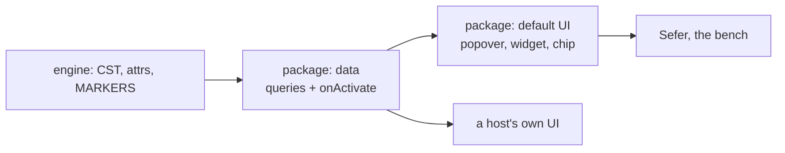

Found on the [editor bench](/items/2026-10-14-form-mode), the day it was built: copying
from the BSB beside the ULB, and the "Every marker" scenario showing what Reading mode still
draws as raw USFM.

> If I go copy and paste inside of a WYSIWYG editor, such as Microsoft Word, and I copy that
> as one and then I paste it later. The bold comes with it in Microsoft Word or in Docs and it
> doesn't here. So I think it's the default of text plain that's odd.

## What the bench showed

- **Copy writes one flavour**, `text/plain`, holding the raw USFM of exactly the selected
  characters. Dragging across a title in Reading starts after the hidden `\s1 `, so the title
  comes without its marker; the same for bold. Pasted into an email, the same copy is full of
  backslashes.
- **A paste is the text, verbatim.** BSB 1:5's end through "His name was John." pasted at
  the end of ULB 1:5 gives `…overcome it.\s1 The Witness of John`: the title glued to the
  verse, not a heading, and a second `\v 6`. With the caret in the number slot (`\v |6`) it
  gives `\v \s1 The Witness…`. Poetry the same: `comfort me.\v 4 Even though…`. No rule
  refused or rewrote any of it.
- **Reading mode still shows backslashes** for `\cp`, `\pb`, tables, `\fig`, sidebars and
  `\cat`, and a milestone's attributes (`|who="Speaker"`).
- **Milestone pips are big** (`\list-s\*` draws three boxes), and the caret can stop inside
  one (`\list-s|\*`).

## The principle: data in the package, the UI an opt-in default

> try to be generic enough that we can do it here in our workbench, but not force it on a
> caller … if they don't want those attribute popovers they shouldn't 100% have to show them,
> but also, if the data part is generic / abstracted enough to do with as they want, and we
> can ship a default solution as well

Each feature splits in two:

- **The data, always in the package, framework-free.** "A milestone at 120–140 with these
  attributes", "a figure with this caption and `src`", "a marker this surface has no renderer
  for". Plain queries on the handle, and events (`onActivate({ kind, range, attributes })`)
  a host can drive its own UI from.
- **The default UI, as opt-in extensions.** The attribute popover, the figure widget, table
  layout, chips. The mount takes a feature list, the full set by default; Sefer and the bench
  take the defaults, another host passes its own, leaves popovers out, or listens to
  `onActivate`.

The bench is where each is proved first: a feature that only works when Sefer wires it shows
up there. CodeMirror's own model, a small core and behaviour in extensions.

Ruled 2026-10-22, built in `1e733323`: opinionated UI is **off by default**, CodeMirror's way.
`mountBookEditor({ features })` takes `verseMenu()`, `attributePopover()`, or `editorFeatures()`
for all of them (the `basicSetup` of this editor); Sefer and the bench pass `editorFeatures()`.
The verse menu's edits are plain commands (`core/verseCommands.ts`, and `renumberVerse`,
`removeVerseMarker`, `addVerseAfter` on the mount). Chips' UI joins the bundle the same way.

Ruled 2026-10-22, after figures and chips first went around it: **every kind of markup goes
through the registry**: a class, an owned set, mapping rows, the plan's resolution and atoms.
Keys then follow the cells (what a press may do to a figure, a chip, a caption), deletion
follows the owned set, and a projection can lock or hide any of it. A feature only draws:
`figures()` is the picture resolver over the `figure` class, `markupChips()` the renderer over
the `unruled` class. If the abstractions do not fit, they are extended (as `step` and `stop`
were) and talked over, not routed around.

> Stick to our abstractions, and if those don't work, let's talk.

<Mermaid id="split" caption="One feature, two halves">

</Mermaid>

## Is it kitchen work?

Almost none of it. Kitchen already ships what is needed: `mask` (reader text), `attrs`
(attributes), `parseText` (to read a pasted fragment) and `MARKERS` (each marker's kind).

| Piece | Where |
|---|---|
| `text/plain` | ours, over kitchen's `mask` "text" recipe (Galley's reader text keeps notes, ours drops them: decide which a copy wants) |
| `text/html` | ours: kitchen has no HTML renderer; drawn from the classes the editor paints with |
| the private USFM flavour, widening, the paste rules | ours |
| milestone stops, pips, popovers, chips, `\cp`, `\pb`, lists | ours |
| figures, sidebars, tables | ours |
| two marker configs on one page | kitchen, the per-handle registry, already coming |

<Followup id="kitchen-attrs" done>Attributes through kitchen. Kitchen declined the dish section (an aligned book carries 4 to 8 attributes a word; most parses never read them) and ships instead: `MARKERS` gains `attributes` and `defaultAttribute` columns, and `reader.ts` a pure-TS `attrResolve(name, markerIdx)` kept identical to onion's by a conformance test. No wire change. Done on our side (`Analysis.attrs`, kitchen's `attrs` bound by the host; `parseAttributes` gone). Left for the tag: delete `TAKES_ATTRIBUTES` in `core/attributes.ts` for the `MARKERS` columns, and decide a word's pip by whether it has an `AttrList` token.</Followup>

<Question id="fragment-door">Widening a selection to whole markers is ours first, over the CST the editor already walks (`notePartsOf` does this kind of walk). If nesting gets hairy (a character marker in a note in a character marker), ask kitchen for "the smallest well-formed fragment covering this range"?</Question>

## 1. The clipboard writes three flavours

| Flavour | Holds | For |
|---|---|---|
| `text/plain` | the words a reader sees | email, chat, any plain field |
| `text/html` | the same words, styled: headings, bold, poetry indents | Word, Docs |
| `web application/x-sefer-usfm` | the widened USFM, and the book it came from | a paste inside Sefer |

The private flavour is what Sefer's own paste prefers; everything else reads the other two.

## 2. Widening: what a copy covers, Word's rules

- **Character formatting always comes.** Half a bold word copies bold: the fragment is
  wrapped in the character markers it sits inside.
- **A block's marker comes when the selection reaches the block's end** (Word's
  paragraph-mark rule): a title selected through its end copies as `\s1 …`.
- **A note comes whole** when its caller is in the selection.

## 3. Paste

- **A block-led fragment into an empty block replaces it.** Enter after `\c 1` makes an empty
  `\p`; pasting a copied title there gives `\s1 The Beginning`, not `\p The Beginning`. Which
  markers are blocks comes from the engine's `MARKERS` (kind), not a regex.
- **A block-led fragment mid-line starts a new line.** No more `overcome it.\s1`.
- **Verse numbers are dropped when the copy came from another book**, and kept for a cut and
  paste within one's own text, which is moving verses.

> I'm just imaging somehow going, oh, I want a section heading/title here. Copy from source
> (english) and then backspace it all, then type your heading for example.

- **Never into a number slot.** A paste with the caret in `\v |6` lands at the verse's text.

The paste is still one `input.paste` transaction, so the rules that judge pastes today still
judge it: `refuseMarkupPastedInsideAWord` and `refusePastesThatWouldAddAChapter`
(`packages/editor/src/core/input.ts`), and line by line's `pasteAsOneLine`
(`packages/editor/src/core/verseLines.ts`).

<Source path="packages/editor/src/core/input.ts" lines="209-260" />

## 4. Milestones

One small pip at the start and one at the end, whatever the spelling (`-s`, `\*`); the inside
is no caret stop, as a character marker's chrome is not. Attributes are not drawn.

## 5. Attribute popovers

Attributes (`|who="Speaker"`, a `\w`'s lemma, a figure's `src`) open in a popover from the
pip or the run, as a note's attributes already do, read through kitchen's `attrs`. The data
half is `onActivate`; the popover is the default UI over it.

## 6. Chips: Reading never shows a backslash

Anything without a renderer becomes a small labelled chip ("table cell", "figure", "page
break"), labelled from the catalogue, that the caret goes around and USFM mode edits. A host
can replace the chip renderer. Then, cheaply, three of them get their own drawing:

- `\cp`: its value in the chapter number's place.
- `\pb`: a thin rule, deleted whole, as `\b` is.
- Lists: an indent per level and a hanging indent; `\li#` are already paragraphs and `\lik`,
  `\liv` already character markers.

## 7. Last, one at a time: figures, sidebars, tables

Each in its own module, loaded with a dynamic `import()` the first time a document has one,
so most books never load it.

- **Figures.** `\fig…\fig*` replaced by a widget: the caption, a thumbnail when `src`
  resolves (usually not, so a placeholder), the caption edited in a satellite as a note's
  body is.
- **Sidebars.** `\esb`…`\esbe` drawn as a bordered region with line decorations; `\cat`
  handled.
- **Tables.** One row a line, cell markers as small column pips, columns aligned by
  measuring, not mutating. A mutation observer would fight CodeMirror, which owns its DOM and
  rewrites lines. Instead, in CodeMirror's measure cycle, measure each cell's text (canvas
  `measureText`, or [pretext](https://github.com/chenglou/pretext)), take each table's column
  widths, and give each cell an inline-block mark whose `min-width` reads a per-table CSS
  variable. Remeasure only when a table's text changes.

> My think on tables is i'd want them like, maybe lazy loaded? Or pretty modular off in terms
> of own code.

## Order

Clipboard, widening, paste, milestones, popovers, chips; then figures, sidebars and tables,
one at a time.

<Followup id="clipboard" done>1–2: the three flavours and widening. `e93ed79f`, `packages/editor/src/core/clipboard.ts`. A block's marker comes when the selection takes the block's whole text or runs out of it; a selection that stops at the block's last word does not take it (Word's paragraph mark, refined on the bench).</Followup>
<Followup id="paste" done>3: the paste rules. `ba47eee4`. Beyond the plan, found on the bench: a heading pasted at a verse's first word goes before the verse's number; a chapter line takes no text (after its number is the next line's start); a fragment with no block, at a line a block marker opens, goes after that marker; line by line pastes verse words only. `refuseKeystrokesInsideHiddenMarkup` (`core/sealed.ts`) now lets a paste of whole lines at a line's start through, or a heading could never go above a verse.</Followup>

<Followup id="marksup-analyzer" done>Found while wiring paste: `refuseMarkupPastedInsideAWord` parses a slice of the line through the book's own `analyze` (`marksUpInContext`, `packages/editor/src/core/compose.ts`). In Sefer that is `galley.memoize(book.id)`, which calls `handle.update(id, slice)`: the engine's copy of the book becomes one line until the next keystroke re-parses the whole text, and its memo is spent. Likely harmless today (the next parse restores it), but a lint or TOC read in between sees the slice. A fragment wants the free `analyzeText`, not the book's. Ruled 2026-10-22: no parse at all, a marker pattern (`\name` or `\*`); done.</Followup>
<Followup id="milestones" done>4: milestone pips and stops. One span per milestone in the line table (marker, attributes, terminator), one atomic pip, smaller. The dark box beside `\list-s` was the pip itself, inheriting its paragraph's first-line indent (`f4f4da6e`).</Followup>
<Followup id="popovers" done>5: attribute popovers, data first. `9ac97ee0`. Data: `core/attributes.ts` and `BookEditorMount.attributesAt / onActivate / setAttributes`. UI: `recipes/attributePopover.ts`, off with `attributePopover: false`. Keys locked, values editable, as the aligned-word popover removed in `00d397e3` ruled (an attribute key is spec vocabulary); its stylesheet reused. Attributes are read off the list's span in TypeScript (`key="value"` pairs or one bare default), not through kitchen's `attrs`, which is a wasm call the package does not make; if they ever disagree, `attrs` is the arbiter. Not yet on the reference or a reader (read-only there). A host must wrap the editor in `.cm-host`: the package's tooltip rules are scoped to it.</Followup>
<Followup id="chips" done>6: chips. `c96b4f65`. Data: `core/unsupported.ts` (markup the editor's own decorations leave showing, with a reader's label) and `BookEditorMount.unsupportedMarkup`. UI: `markupChips(render?)`, in `editorFeatures()`. The caret's stops learned `featureAtoms`, so a chip is crossed in one step.</Followup>

<Followup id="chip-graduates" done>The three cheap ones get real drawings, after which they stop being chipped on their own: `\cp` in the chapter number's place, `\pb` as a thin rule deleted whole, list levels as indents with a hanging indent. Done: lists in CSS; `\pb` (a rule) and `\cp` (a "published as" caption under the chapter number) in the chips feature's default renderer, since they are already atomic and deleted whole there. `\cp` is not moved into the chapter number's own place: that would hide a line of text Reading could then not edit.</Followup>
<Followup id="figures" done>7a: figures. A badge (the picture through the host's `resolveSource`, else a frame and the file name) and the caption as ordinary editable text; attributes and `\fig*` hidden and atomic; the badge opens the attribute popover. Not lazily loaded: the module is small and reads only tokens, so its own file is enough. Tables are where laziness pays.</Followup>
<Followup id="sidebars" done>7b: sidebars. A container class (`sidebar`, ambient × via-anchor) with an owned set; its markers hidden chrome; a container resolves none of its children's lines; the box drawn as line classes; `\cat` a run around words. `blockAt` prefers a block inside a container (Enter in a sidebar makes a `\p`). Not lazy: it is on the synchronous layout path.</Followup>
<Followup id="container-deletion" done>Ruled 2026-10-22, Word's text box: a container's edges are fences (no Backspace or Delete joins across one); an empty container is taken whole; a selection crossing one edge is refused, the whole container or a range inside one is ordinary. A `fenced` cell rule and the container's own target (`owned.ts`, `deletion.ts`). The refusal's note still reads as the generic "a set whose cell refuses the keyboard".</Followup>

<Followup id="tables">7c: tables. A `table` class for rows and cells (today `unruled` chips), drawn plainly and synchronously by the core. The measured column layout is the one part loaded lazily: an extension imported the first time a book has a `\tr` and installed by reconfiguring a compartment, so layout never waits on an import; until it arrives a table is merely unaligned.</Followup>

