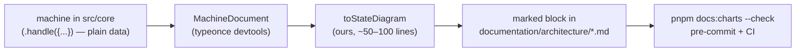
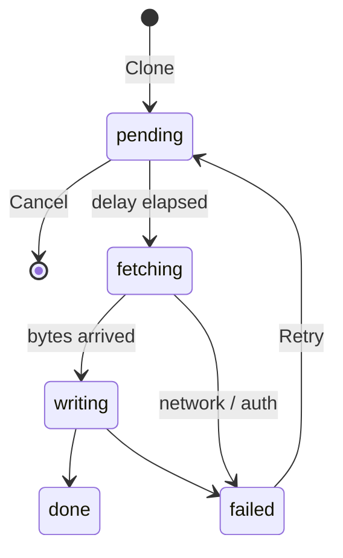
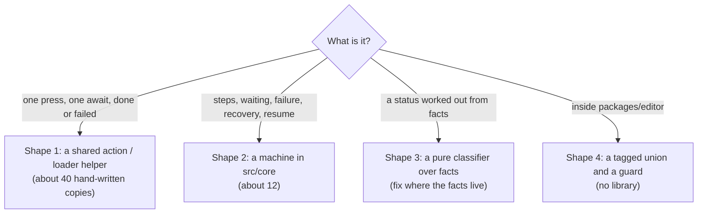

Model Sefer's processes as explicit state machines in `src/core`, and generate their charts
into the documentation from the machine itself, so the chart cannot drift from the code.

> there's a lot to our app that is a state machine. Getting stuff on disk, loading, tours

> I'm not against effect being kind of one of Sefer's main dependencies. And modeling, you
> know, BTT writer consolidation and the Git remote lifecycle, especially, all modeled as a
> state machine with a diagram programmatically generated, sounds pretty good.

> I don't want to bring that into the core editor package.

**Where it stands (2026-10-23): our current leans, not started.** PR #7 has landed (`624a2b45`),
so nothing blocks it on that side, but a tutorial for the PO comes first. Everything below is
what we lean towards today; reopen it, and the questions at the end, before building.

<Followup id="after-po-tutorial">Come back to this after the PO tutorial: re-read the leans, answer the open questions, then step 1.</Followup>

## The rule: processes are machines, status is a classifier

- **Processes** (steps, waiting, failure, recovery) become machines: the git remote lifecycle
  (clone, fetch, push, combine, retry, refusals, stranded), the Writer consolidation, getting
  things onto disk and loading, tours.
- **Status derived from facts** stays a pure function. `syncStateOf` in
  `src/core/sync/state.ts` reads git and remote facts; a machine would hold a second copy of
  "we're ahead" that can disagree with the repository. Its chart comes from its rules made
  data (an ordered rule list plus a `satisfies Record<SyncState, SyncActionId>` action table).
- **`packages/editor` stays a pipeline.** No machine library in it; `pnpm boundaries` should
  enforce that, not a convention.

## The library

`@typeonce/effect-machine`: Effect 4, Schema-first, compound and parallel states, history,
`always`, final states, and every target of a conditional choice declared up front. Its
topology is captured from the declarations, and its devtools expose a serialisable
`MachineDocument`. Chosen over XState v6's `@xstate/effect` (experimental, on XState's `next`
branch, React-only bindings) and `@humanlayer/effect-machine` (targets live inside handler
functions, so nothing can draw it).

<Tradeoff id="fork" chose="Fork typeonce into our org" cost="We carry upgrades ourselves">
Pre-1.0 with breaking changes in minor releases, and its peer dependency is stable
`effect ^4.0.0` while Sefer is on `4.0.0-rc.112`. The fork loosens the peer dependency so the
first step adds one dependency and does not bump Effect. Moving to Effect 4 stable is its own
change, later.
</Tradeoff>

## How a chart is generated

<Mermaid id="pipeline" caption="From machine to the chart in the docs">

</Mermaid>

- `tools/docs/charts.ts` imports a short, explicit list of machines (not typeonce's scanner),
  so each chart lands in the doc we choose.
- Nested states become `state X { … }`, parallel regions `--`, guards edge labels, a choice
  with several targets a `<<choice>>` node.
- Output goes between marker comments such as `<!-- generated:remote-lifecycle -->`, the same
  trick as `pnpm lint:results`. `--check` exits non-zero if the file would change.
- Runs in Node like the unit tests; fine because `src/core` is free of browser APIs.

<Question id="document-api">Does the fork's `MachineDocument` expose the topology as the README suggests? First thing to read in the fork's source; if not, walk the `.handle({...})` object ourselves.</Question>

## Steps

1. Fork typeonce into the org; loosen the peer dependency to accept `4.0.0-rc.112`.
2. In a worktree, write the **git remote lifecycle** as one machine, used from one call site
   behind the existing functions. No UI change.
3. Generate its chart into `documentation/architecture/sync.md`, with `--check`.
4. Stop and judge: does the code read better, is the chart honest, how much does the Solid
   binding (snapshot into a signal, one subscription per source) cost?
5. If yes: Writer consolidation, then disk and loading, then tours.

## Already in the code

PR #7 brought a first instance of the cancel window: the reference panel's language list
waits two seconds ("Starting… Cancel") before a gateway Bible's clone begins
(`DOWNLOAD_GRACE_MS` in `src/app/ui/workspace/ReferenceColumn.tsx`). It is component state
today; when the remote lifecycle becomes a machine, this is its `pending` state and the
component only reads it.

## Cancelling a clone: a delay, not a cancel

> cancellation doesn't really help a ton on git clone, because, like, at best, you have to
> just ignore the response. So I'd probably actually prefer his just add the delay, like the
> Gmail trick, add the delay with the cancel button.

Once the request for a zip is sent the bytes come back regardless; Effect's interruption only
lets us ignore them. So the lifecycle gets a short **pending** state before the network
request, with Cancel offered there (the Gmail "undo send" shape). Raised by the designer's
Claude on PR #7.

<Mermaid id="clone-delay" caption="The cancel window lives before the request">

</Mermaid>

<Question id="delay-length">How long is the window: a few seconds, or until the person confirms?</Question>

## Inventory: the implicit machines (2026-11-09)

> Find all of the implicit state machines in my app (there are probably a ton). Make the best
> decision that will elevate all three: the user experience (UX), developer experience (DX),
> and agent experience (AX) always, without breaking anything. Also, make state machines
> explicit.

Written against `f6885546`. Four readers went through every non-test file in `src/core`,
`src/app`, `src/platform`, `src/routes`, `src/dev` and `packages/`. **Everything below comes
from reading the code, not from running it**: "bug" means the lines as written allow it, and
none was reproduced in the app. Five were re-read by hand and hold: the stuck `recording`
flag, two opens of different roots, `onDisk` never cleared, the picks migration, and the
typed marker's missing exit guard.

There are about sixty. They fall into four shapes, and each shape wants a different tool.
That is the decision this section proposes: **not one library for everything, one tool per
shape.**

<Mermaid id="four-shapes" caption="Which tool a piece of state gets">

</Mermaid>

### Shape 1: the same three small machines, written out forty times

No library, no chart. One helper each, in `src/app/ui/primitives/`, and the copies go.

| Pattern | States | Copies | What the copies get wrong |
|---|---|---|---|
| **One-shot action** (a busy flag, a toast, reset in `finally`) | idle, running, failed | about 20: `cloud/quick.ts`, `cloud/account.ts`, `CollabModeCard`, `CollabSection`, `PublishSection`, `SuggestionsCard`, `YourSuggestions`, `WriterFollowCard`, `SourceTextsCard`, `UpdatePanel`, `RecoveryBanner`, `SuggestionLine`, `createRecordAction`, `ReviewPanel`, `YourProjects`, `WacsProjects`, `MigrateScreen`, `ReferenceColumn`, `SuggestionsScreen` | They disagree on four things: is a second press refused, does a rejection reset the flag, is the flag per component or per project, is a late result dropped. |
| **Load for a question, latest wins** | loading, value, failed, late | `createHeld` in `primitives/held.ts` already does it and one screen uses it. 8 hand-rolled copies guard stale results; 13 do not (`ReferenceColumn.tsx:155`, `HistoryPanel.tsx:201` and `:286`, `recorded.ts:125`, `SuggestionLine.tsx:92`, `account.ts:83`, `WriterFollowCard.tsx:22`, `findSource.tsx:114`, `WacsProjects.tsx:500`, `ReviewPanel.tsx:106`, `BookPane.tsx:240`, `SourceTextsCard.tsx:84`, `OpenByLink.tsx:81`, `createSides.ts:182`) | An older answer lands after a newer one; a failure leaves the spinner on for good. |
| **Confirm, then act, on one row** | idle, confirming(row), acting | 8: decline with a note (three places), withdraw, stop following, move to my projects, rename, delete | Some close the confirm before acting and lose the typed note on failure; one move's finish closes another row's confirm (`SourceTextsCard.tsx:104`). |

What a person sees today because of these, as read:

- **Record a version can spin for good.** `record()` sets `recording` and has no
  `try`/`finally` (`createRecordAction.ts:364-370`); and a second press during the author-name
  write starts a second record (the guard is at `:334`, the flag is set at `:364`).
- **Send can run twice at once.** `createQuickSync` is built separately by the sync popover
  and the review line, each with its own `busy` (`cloud/quick.ts:117`).
- **A failed "Create and publish" shows nothing in its card.** It writes `account.problem`,
  which only the sign-in form and the account popover draw.
- **Catalogue rows unlock mid-download.** One `busy` id for all rows
  (`WacsProjects.tsx:545`), cleared by whichever download ends first.
- **History can show version A's changes under version B** (`HistoryPanel.tsx:286`, no ticket).
- **Open by link, Update check and History can spin for good** on a rejection (no `catch`).
- **Rename reopens itself** after a successful rename, while `?rename=` stays in the URL
  (`YourProjects.tsx:157-171`).

### Shape 2: the real processes

These have steps, waiting, failure and a way to resume. They are what this plan's "machines
in `src/core`" means. Ordered by what making them explicit buys.

| # | Process | Where | Held today in | What the code permits today |
|---|---|---|---|---|
| 1 | **Opening and closing a project** | `app/shell/lifecycle.ts:138-251`, `routes/_app/project/$slug.tsx:14-33` | `project`, `live`, `let opening`, `recoveryOffer` (undefined = pending), the route's own `phase` | Two different roots opening at once (`:161` only dedupes the same root): the first project's seats and recovery mount leak, and the second URL briefly draws the first project. A failed open is an empty page with no message. A throw after open leaves the spinner on. |
| 2 | **Record a version, then send** | `ui/review/panel/createRecordAction.ts`, `createReceipt.ts` | `recording`, `recordedLine`, `sendLine`, `form.recordOpen` | As above; also a send that lands after the dialog closed writes its line into nothing. |
| 3 | **The backup journal** | `core/recovery/recovery.ts`, `reopen.ts` | three Sets, a Map, and file names on disk | `flush` is not serialised with `discard` or `compact`: a discarded journal can be written back. A save deletes the set-aside journals the banner is still offering. |
| 4 | **Save and the changed-on-disk conflict** | `core/save/saveCoordinator.ts` | `baselines`, `conflicts`, a semaphore | The conflict check is before the write and not after: a change landing during a save is overwritten. `saveAll` can save half and report nothing saved. |
| 5 | **Combine and receive** | `core/sync/combine.ts`, `receive.ts` | `CombineState` set at about 8 sites; receive has no state type | `giveBack` returns the books it could not put back and both callers discard that (`combine.ts:344`, `:441`; `receive.ts:182`), so "restored" can be untrue. |
| 6 | **Something arriving on disk** (clone, download, import, assemble, add books) | `core/remote/clone.ts`, `core/resources/import.ts`, `core/migrate/assemble.ts`, `app/arrival.ts`, `ui/landing/importFlows.ts`, `catalogueDownload.ts`, `ReferenceColumn.tsx` (the grace window) | five separate progress shapes; no marker on disk | A folder exists before it is complete and `repairProjectIndex` lists any folder as a project, so an interrupted clone or assemble is a broken project in the list. `addBooks` has no rollback and its retry is refused. Import records the arrival before the copy. Import's dialog says Ready and then Failed. On desktop two transfers share one progress stream. |
| 7 | **Collaboration mode and its remotes** | `app/suggestions.ts:155-239` | a setting plus `origin`/`copy` in git config | `suggestTo` re-points `origin` before the fetch; offline, the old origin is not kept anywhere. |
| 8 | **Sign-in** | `ui/cloud/account.ts`, `core/remote/gitea.ts` | `session`, `busy`, `problem`, `otpWanted` | One `problem` slot for unrelated operations; a slow session restore can overwrite a fresh sign-in. |
| 9 | **Tours** | `app/tour/machine.ts`, `TourOutlet.tsx` | a real `phase` union, plus `paused` and `lost` as separate signals | Closest to explicit already. Waiting to start is not a state; a lost anchor leaves the card with no ring. |
| 10 | **Migrate from Writer** (the run, not each book) | `ui/migrate/MigrateScreen.tsx` | `step`, `busy`, `assembling` | "Add more" stays live while assembling. |
| 11 | **Project analysis** | `core/analysis/projectAnalysis.ts` | `Entry.stale`, a second hand-rolled debouncer | "The engine refused" looks exactly like "still working". |
| 12 | **The diagnostics log writer** | `app/diagnostics.ts:77-165` | seven `let`s | One failed write stops logging for the session; `status()` says "writing" after stop. |

Two things in the code already do this well and are the model to copy, with no library:
`step` in `src/core/git/repository.ts:60-101` (one reducer, applied atomically) and `reduce`
in `src/app/ui/multibuffer/cardState.ts:41`.

One likely data-loss path that is not a machine but turned up: the picks migration in
`src/core/resources/library.ts:349-362` ignores a failed write of the new home and then
deletes the old one.

### Shape 3: status that should be worked out from facts, and is not

The rule above stands: these stay classifiers. The holes are in where their facts live.

- **Save state** (`app/shellStores.ts:118`): `onDisk` is a plain Set keyed by book id, fed by
  this session's events and never cleared. Save MAT without recording in one project, open
  another, and its MAT reads "saved, not recorded". Reopen a project with uncommitted files
  and they read "recorded".
- **Sync status** (`app/syncStatus.ts`): `sendRefused` and `lastFailure` are global, so one
  project's refused send shows on the next project.
- **The app bar's Refine / Form control** (`workspace/AppBar.tsx:215-236`): reads as selected
  on Settings, History, Findings and Review, and pressing it there does not navigate.
- **`SyncState` copy**: five separate switches over the ten states (`copy.ts`, `quick.ts:20`
  and `:57`, `SyncButton.tsx:40`, `SyncLine.tsx:42`). One `satisfies Record<SyncState, …>`
  table would hold them.

### Shape 4: the editor

Stays a pipeline, no library. Most of its state is already a `StateField<X | null>` with one
effect, which is the explicit form. What is held in loose closure variables instead:

| What | Where | Hole |
|---|---|---|
| **The typed marker** (`\q2` being typed) | `core/inputRules/typedMarker.ts:46-54`, `:150` | Mode and read-only are checked on entry only. Flip to USFM or set read-only mid-type and it keeps composing; Space then writes into a read-only editor. |
| **The Book's seat** (unbound, bound, closed) | `packages/editor/src/book.ts:198-216`, `:410-447` | `close` while bound drops the live text for the stale one; nothing checks "closed"; a displaced view still publishes. |
| **A reader after `destroy`** | `surfaces/reader.ts:195` | A second `destroy` puts one view in the pool twice, so two cards share it. |
| **The aligned group's lead** | `surfaces/align.ts:123-235` | A queued frame can make an editor that has left the lead. |
| **The note editor** | `surfaces/noteEditor.ts` | An edit above an open note remounts it and loses the caret (plausible, not tried). |
| **A card's dirty flag after Cancel** | `surfaces/card.ts:97-107` | May stay dirty (plausible, not tried). |

### What this changes in the plan

The plan above starts with the git remote lifecycle on a forked library. The inventory says
most of the harm is elsewhere and most of it needs no library:

1. **The two helpers first** (the action runner, and `createHeld` everywhere). Smallest
   change, most screens fixed, nothing in `src/core` moves. For people: no stuck spinners, no
   double sends, every failure says so. For us and for agents: one way to write a button
   that does something, and the building-blocks skill names it.
2. **Then the processes, one per commit, behind the functions that exist now**, starting with
   opening a project and record a version, written the way `repository.ts` `step` is: a
   tagged union, one `step(state, event)`, the transitions as data so the chart can be
   drawn from them.
3. **The status holes** as plain fixes alongside (they are a few lines each).
4. **The editor's four guards** as plain fixes in `packages/editor`.

<Question id="library-still-first">Does the forked `@typeonce/effect-machine` still come first? The inventory's worst processes (open a project, record a version) are flat: five to seven states, no nesting, no parallel regions. A tagged union and one `step` function, as `src/core/git/repository.ts` already has, covers them, and a chart can be drawn from a transition table as easily as from a `MachineDocument`. My recommendation: write the first two that way, and bring the library in only when a process needs nesting or parallel regions (the arrival lifecycle with its cancel window is the likely first).</Question>

<Question id="first-machine" answer="Both, and only these two: opening a project and record a version are the machines that earn state charts (2026-11-09).">Which process goes first: opening a project (the spine, three holes), or record a version (the app's one deliberate write, two holes)? The plan said the git remote lifecycle; the inventory puts it sixth.</Question>

<Question id="reducer-tests">A `step(state, event)` function is pure, like the Citation parser. Do the machines' transition tables earn tests now, under the "no new tests until behaviour is locked" rule, or are they driven in the app only?</Question>

<Question id="arriving-marker">Should a project folder carry an "arriving" marker until its clone, import or assemble finishes, so an interrupted one is swept instead of listed? It closes the crash holes in clone, import and assemble together, and it changes what is on disk.</Question>

<Followup id="reproduce-before-fixing">Before fixing any hole listed here, reproduce it in the app or say it could not be reproduced. The list is from reading.</Followup>

### Measured against two rules, and what was ruled (2026-11-09)

The two rules: no helper extracted ahead of reuse, and no complexity for an unlikely race
without saying the failure, the likelihood and the cost first. Against them:

- **Stands:** the one-shot action helper (about 20 real copies), `createHeld` for loaders, and
  the failures that are not races fixed where they are.
- **Withdrawn:** the confirm-then-act row helper (the 8 copies differ on purpose), the one
  table over the five `SyncState` switches (five different mappings), and machines for the
  update check, the diagnostics writer, the migrate run, analysis status and sign-in (each is
  small and used once; a tagged union in the same file is enough).
- **Deferred:** the library fork and the chart generator until two machines exist; the
  "arriving" marker; the editor guards other than the typed marker.
- **Dropped from the ranking:** the backup journal and the save coordinator. Their case rests
  on windows of milliseconds.

> I think I agree these are likely the big machines most deserving of actual state charts
> potentially

Said of opening a project and record a version: those two are the machines.

> AGree fix all

Said of the races a person could plausibly hit. Done on branch `fix/plausible-races`, from
reading, none reproduced in the app first; `pnpm check` and `pnpm test:browser` pass:

- **Catalogue rows:** the busy id is a set, so one download ending no longer unlocks another's row.
- **History:** a ticket on the shown changes, so an older version's answer cannot land last.
- **Send:** one busy flag for the app, keyed by project, shared by the sync popover and the review line.
- **Two projects opening:** a second root waits for the open in flight; the route ignores an answer for an address it has left.
- **The typed marker** (ruled "can fix if only two lines"): the marker being typed is dropped when the editor leaves Refine or turns read-only.

<Tradeoff id="progress-crosstalk" chose="Left two transfers sharing one progress stream" cost="While two transfers overlap, each one's progress line can show the other's numbers">
I called this cheap and it is not. `Progress` carries no transfer, on either host: tagging it
means a field on the core type, the desktop's Rust event, the Web's byte counter (which sits
under the fetch and does not know its transfer) and three subscribers. Both transfers still
finish correctly; only the numbers are wrong while they overlap.
</Tradeoff>

<Followup id="record-twice">Once the action helper exists, Record a version takes its re-entry guard from it (ruled: "If free, sure once helper exists").</Followup>

### The two machines are built (2026-11-09)

On branch `fix/plausible-races`, with no library: a tagged union, an event union, a table of
which events each phase answers, and one `step` function, in `src/core`. The shell or the
panel keeps the phase and sends events; screens only read it.

<Machine id="project-phase" machine={{
  id: "project",
  initial: "closed",
  states: {
    closed: { on: { ask: "opening" } },
    opening: { note: "An answer about another root changes nothing. Opens run one at a time.", on: { ask: "opening", opened: "open", refused: "failed", close: "closed" } },
    open: { on: { ask: "opening", close: "closed" } },
    failed: { tone: "danger", note: "A screen that says why, with Try again and Back to projects.", on: { ask: "opening", close: "closed" } }
  }
}} />

`src/core/project/lifecycle.ts`. The project route keeps no phase of its own. New for a
person: a project that will not open says why (it was a blank page).

<Machine id="record-phase" machine={{
  id: "record",
  initial: "editing",
  states: {
    editing: { on: { start: "recording" } },
    recording: { note: "No way out by close or by a second start.", on: { stopped: "editing", answered: "recorded" } },
    recorded: { note: "Carries the receipt line and the send line (nothing, sending, or a line).", on: { start: "recording", sending: "recorded", sent: "recorded", close: "editing" } }
  }
}} />

`src/core/save/recordPhase.ts`. New for a person: a record that throws ends on a receipt
that says so (the button spun for good), and Save pressed twice records once.

- **Driven in the app:** opening the fixture project; a project folder with no books (the
  failure screen, Try again, Back to projects); the first-ever save with Save pressed twice in
  one instant, then History showing one version.
- **Not driven:** two real projects opening at once, a review against the shared project, a
  decline, a record that throws, desktop.
- **Found on the way:** Solid 2 batches signal writes, so a guard that reads the phase signal
  is blind to a second press in the same instant. Both machines keep the phase in a plain
  variable and the signal only draws it. The action helper will need the same.

<Followup id="charts-due">Two machines exist now, so the chart generator is no longer ahead of need: `tools/docs/charts.ts` reading the two transition tables into `shell.md` and `review.md`, with `--check`. The tables are not exported yet because nothing reads them.</Followup>
