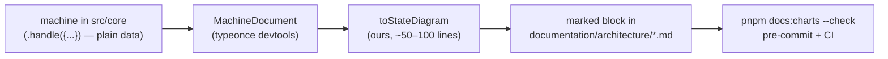
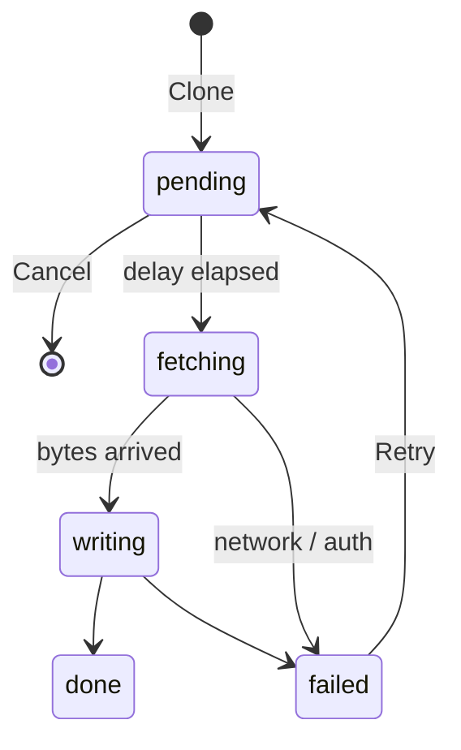

Model Sefer's processes as explicit state machines in `src/core`, and generate their charts
into the documentation from the machine itself, so the chart cannot drift from the code.

> there's a lot to our app that is a state machine. Getting stuff on disk, loading, tours

> I'm not against effect being kind of one of Sefer's main dependencies. And modeling, you
> know, BTT writer consolidation and the Git remote lifecycle, especially, all modeled as a
> state machine with a diagram programmatically generated, sounds pretty good.

> I don't want to bring that into the core editor package.

**Where it stands (2026-10-23): our current leans, not started.** PR #7 has landed (`624a2b45`),
so nothing blocks it on that side, but a tutorial for the PO comes first. Everything below is
what we lean towards today; reopen it, and the questions at the end, before building.

<Followup id="after-po-tutorial">Come back to this after the PO tutorial: re-read the leans, answer the open questions, then step 1.</Followup>

## The rule: processes are machines, status is a classifier

- **Processes** (steps, waiting, failure, recovery) become machines: the git remote lifecycle
  (clone, fetch, push, combine, retry, refusals, stranded), the Writer consolidation, getting
  things onto disk and loading, tours.
- **Status derived from facts** stays a pure function. `syncStateOf` in
  `src/core/sync/state.ts` reads git and remote facts; a machine would hold a second copy of
  "we're ahead" that can disagree with the repository. Its chart comes from its rules made
  data (an ordered rule list plus a `satisfies Record<SyncState, SyncActionId>` action table).
- **`packages/editor` stays a pipeline.** No machine library in it; `pnpm boundaries` should
  enforce that, not a convention.

## The library

`@typeonce/effect-machine`: Effect 4, Schema-first, compound and parallel states, history,
`always`, final states, and every target of a conditional choice declared up front. Its
topology is captured from the declarations, and its devtools expose a serialisable
`MachineDocument`. Chosen over XState v6's `@xstate/effect` (experimental, on XState's `next`
branch, React-only bindings) and `@humanlayer/effect-machine` (targets live inside handler
functions, so nothing can draw it).

<Tradeoff id="fork" chose="Fork typeonce into our org" cost="We carry upgrades ourselves">
Pre-1.0 with breaking changes in minor releases, and its peer dependency is stable
`effect ^4.0.0` while Sefer is on `4.0.0-rc.112`. The fork loosens the peer dependency so the
first step adds one dependency and does not bump Effect. Moving to Effect 4 stable is its own
change, later.
</Tradeoff>

## How a chart is generated

<Mermaid id="pipeline" caption="From machine to the chart in the docs">

</Mermaid>

- `tools/docs/charts.ts` imports a short, explicit list of machines (not typeonce's scanner),
  so each chart lands in the doc we choose.
- Nested states become `state X { … }`, parallel regions `--`, guards edge labels, a choice
  with several targets a `<<choice>>` node.
- Output goes between marker comments such as `<!-- generated:remote-lifecycle -->`, the same
  trick as `pnpm lint:results`. `--check` exits non-zero if the file would change.
- Runs in Node like the unit tests; fine because `src/core` is free of browser APIs.

<Question id="document-api">Does the fork's `MachineDocument` expose the topology as the README suggests? First thing to read in the fork's source; if not, walk the `.handle({...})` object ourselves.</Question>

## Steps

1. Fork typeonce into the org; loosen the peer dependency to accept `4.0.0-rc.112`.
2. In a worktree, write the **git remote lifecycle** as one machine, used from one call site
   behind the existing functions. No UI change.
3. Generate its chart into `documentation/architecture/sync.md`, with `--check`.
4. Stop and judge: does the code read better, is the chart honest, how much does the Solid
   binding (snapshot into a signal, one subscription per source) cost?
5. If yes: Writer consolidation, then disk and loading, then tours.

## Already in the code

PR #7 brought a first instance of the cancel window: the reference panel's language list
waits two seconds ("Starting… Cancel") before a gateway Bible's clone begins
(`DOWNLOAD_GRACE_MS` in `src/app/ui/workspace/ReferenceColumn.tsx`). It is component state
today; when the remote lifecycle becomes a machine, this is its `pending` state and the
component only reads it.

## Cancelling a clone: a delay, not a cancel

> cancellation doesn't really help a ton on git clone, because, like, at best, you have to
> just ignore the response. So I'd probably actually prefer his just add the delay, like the
> Gmail trick, add the delay with the cancel button.

Once the request for a zip is sent the bytes come back regardless; Effect's interruption only
lets us ignore them. So the lifecycle gets a short **pending** state before the network
request, with Cancel offered there (the Gmail "undo send" shape). Raised by the designer's
Claude on PR #7.

<Mermaid id="clone-delay" caption="The cancel window lives before the request">

</Mermaid>

<Question id="delay-length">How long is the window: a few seconds, or until the person confirms?</Question>
