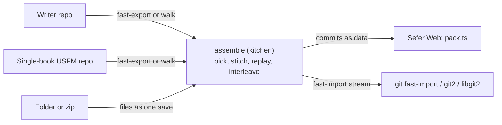

> one day I might see if this could move to scripture kitchen and compile to wasm? Obv need fs, but might could write it all in memory first? Not sure. I just also have this same primitive in … WACs dash 2

(Will, 2026-10-27.)

## Why

The same Writer code now exists twice. `wacs-dashboard-2` (the translation hub,
`WycliffeAssociates/hackathon-translation-hub`) has `crates/stitch` (`hub-stitch`),
ported from `src/core/migrate/writerBook.ts` at `50aa9cd`, and `crates/history`
(`hub-history`), ported from `writerHistory.ts`. Both say they are "kept in step" by
hand, because the hub and Sefer must stitch a Writer book to the same bytes. Keeping
them in step by hand will eventually fail, and nothing would notice when it does.

## What Will wants (2026-10-27)

> I just don't like having an implementation for [it] written inside of [Sefer] itself. Like, I just feel like that should be an external thing.

> the idea is I am taking a bunch of books and bringing them together as a single Bible from independent sources. And I don't know how to abstract that from the file system part that's needed. Because Git is so much based on the file system

> I like to keep its primitives pretty, its code pretty focused on just orchestrating things that already exist, hence the editor is actually not in this repo.

So the aim is wider than Writer. **Assembly** means taking independent single-book sources and making one Bible that keeps every source's history. It should be a library that Sefer calls, the same way it calls the editor and the parser. A person with plain git on a laptop (someone who asked about using git directly) should be able to run the same assembly from a command line, with no Sefer involved.

## The boundary: bytes in, commits out

Git doesn't need a file system to be described. It already has a text format for history in transit: `git fast-export` writes a repository's commits as one stream, and `git fast-import` builds a repository from one. Every commit is in it, with its author, date, message and full file contents. Nothing in the format is a path on disk.

So the library never touches a disk or a git implementation:

- **In:** each source's history, as a list of saves. A save is the commit's author, committer, date, zone and message, plus the files it changed as `path → bytes`. That is exactly what a fast-export stream holds, and what Sefer's `walk` + `blobs` already produce.
- **Out:** the assembled history, as a list of commits to make. Each is the whole book file's bytes at that point, an author, a date, a message (`TIT 1:6–7`), and the `Writer-Message` / `Writer-Source` trailers, interleaved by time. The final assembly commit (`metadata.json`, `manifest.yaml`, `.upstreams.json`) is the last item. This list can be handed back as data, or written as a fast-import stream.

Each host brings its own git to either end, and only the host touches storage:

| Host | Reads sources with | Writes the result with |
|---|---|---|
| Command line, any machine | `git fast-export` per source repo | `git fast-import` into a new repo |
| Sefer desktop | git2 (as today) | git2, or fast-import |
| Sefer Web | isomorphic-git `walk` + `blobs` (as today) | `src/core/git/pack.ts` (as today: one pack, five files on OPFS) |
| The hub (`wacs-dashboard-2`) | libgit2 over its bare repos | libgit2 |

"In memory first" is then just the normal case. A source is a stream or a list in memory, and so is the result. Writing to disk is the last step and belongs to the host.

<Mermaid id="flow" caption="One library; each host brings its git to both ends">

</Mermaid>

## What moves and what stays

**Moves to scripture-kitchen,** as one crate, in the galley wasm build and as a CLI binary:

- **Stitch adapters,** one per source shape. Writer chunks become a USFM book (`writerBook.ts`, `hub-stitch`). A single-book USFM repo passes through. More shapes can be added later.
- **Pick:** one candidate per book, with the rule "Primary, else newest Active, never Inactive" when asked for a recommendation. The UI's choice is passed in as data.
- **Replay** (`writerHistory.ts`, `hub-history`'s pure half): saves become book-file commits, said in verses.
- **The assembly metadata:** the Burrito and RC forms from one prefill (`writeMetadata.ts`'s share), and `.upstreams.json`.
- **The fast-export reader and the fast-import writer.** Both are text formats with no I/O, about a few hundred lines each.

**Stays in Sefer** is orchestration only: the catalogue and the candidate table, cloning, the health line and Compare (which use the editor and Review), materialising commits on the Web (`pack.ts`), and following Writer upstreams afterwards.

**The hub** drops `hub-stitch` and the pure half of `hub-history` and calls the same crate. That removes the hand-kept copies.

<Tradeoff id="fast-import" chose="fast-export / fast-import as the wire format" cost="isomorphic-git has neither, so the Web keeps reading with walk and writing with pack.ts and passes the library data, not streams">Every git on a command line already speaks it, so the CLI case needs no code of ours to read or write a repository.</Tradeoff>

<Question id="history-split" answer="Yes, it splits (Will, 2026-10-27): the library returns commits in memory and the host brings its own git.">Does the pure half of the history replay move as well, or only stitch at first?</Question>
<Question id="pack" answer="Claude's lean, not yet ruled (Will hasn't had time to look, 2026-10-27): move it, as the library's third output beside data and a fast-import stream.">Should `pack.ts` move into the kitchen too, as an optional "write a pack" for hosts with no git of their own? Today only Sefer Web needs it.</Question>

**Lean on the pack writer: move it with the replay.**

- **Only the replay uses it.** `src/core/git/pack.ts`'s one caller is `writerHistory.ts`. If the replay leaves Sefer and the pack writer stays, Sefer keeps git object encoding (zlib, SHA-1, deltas, the `.idx` format) for a job it no longer does. That is the kind of primitive Will wants out of the app.
- **It is already bytes in, bytes out.** Commits go in; a `.pack` and its `.idx` come out. Nothing in it touches storage, so it fits the library's boundary as it is.
- **Any host without a fast-import needs it.** Today that is isomorphic-git on the Web. It would also be any other wasm caller in a browser or a worker. Without it, each of those writes loose objects, which is 1–9 ms each on OPFS. Isomorphic-git's own `packObjects` stores every version whole: 35 MB, against 2.7 MB from ours.
- **Rust does it more cheaply.** Deflate and SHA-1 are mature crates. The delta search is the slow part in JavaScript today, and would run in wasm.
- **The hub doesn't need it, and that's fine.** It's an output the caller asks for, so libgit2 and the command line never pay for it.

So the library has three outputs for one result: commits as data, a fast-import stream, and a pack with its index. Sefer Web writes the last as two files, then adopts them through intake, as now. The first step stays as stitch on its own. The replay and the pack move together after, because a pack is only useful once there are replayed commits to put in it.

<Question id="first-step">Is the first step stitch alone (smallest, and where byte agreement matters most), with replay after?</Question>
<Followup id="golden">Before either side changes, run the hub's `crates/stitch/tests/golden.rs` against Sefer's renderer, so the move starts from proof that the two agree today.</Followup>
