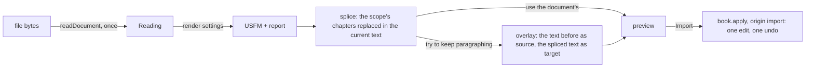

A translator who drafted in Word or LibreOffice brings that draft into a book: a chapter, a range of chapters, or the whole book. The reading is done by the new package `@sefer/document-import` (`packages/document-import`, built 2026-10-29). This plan covers the part inside Sefer: the command, the dialog, the preview, and the one undoable edit. Will ruled on every question on 2026-10-29; the answers are on the questions below. Built on the branch `import-document` (2026-10-29); what changed from this plan on the way is under "As built".

> I would just want this buried in a menu for like import from Word, and then we'd probably want some sort of modal to pop up […] makes them explicitly pick the scope, i.e., the book and or chapters

> if there is an existing text, use our overlay functionality to try to get the paragraph breaks correct, though there should probably be an option for that of keep existing paragraph breaks

## What changes for a translator

1. **Import from Word or LibreOffice…** is in the command palette only, until the designer decides where else it lives.
2. A dialog asks for the file, then shows what was found: chapters and verse counts, missing verses, numbers left as text, tracked changes still in the file.
3. They pick the **scope**: the book, and all of it or some chapters. Typing a citation such as `TIT 2-3` works too, through the address parser we already have (`parseCitation`, `packages/text/src/location/citation.ts`). It starts as the focused book and the chapters the document holds. Only books the project already has can be chosen.
4. **Try to keep this book's paragraphing** is ticked when the scope already has text. Its tooltip: *Keeps the paragraph markers where they were, wherever that can be determined.* Underneath, it is an overlay applied after rendering: the book as it was before is the source, and the rendered document is the target. Unticked, the document's own paragraphs, poetry and headings are used.
5. Switches appear only for what the document actually has: poetry, headings, footnotes, italic, bold, lists, text before verse 1. **Advanced** adds how verse numbers are written, the chapter words, and marker renames.
6. The preview shows the result and updates as they tick. It has the same USFM / plain toggle as the editor, starting from the editor's current mode (`shell.mode()`). **Import** makes one edit, and one Undo takes it back. Nothing is written to disk until **Record a version**, as for every other edit.

<Mock id="dialog" height={300}>
<div style="font: 13px system-ui; padding: 12px; display: grid; grid-template-columns: 260px 1fr; gap: 12px; color: var(--color-fg, #222)">
  <div style="display: grid; gap: 8px; align-content: start">
    <strong>Import from Word or LibreOffice</strong>
    <div>master-titus.docx · <span style="opacity:.7">46 verses in 3 chapters</span></div>
    <label>Scope <input value="TIT 1-3" style="width: 90px" /></label>
    <label title="Keeps the paragraph markers where they were, wherever that can be determined."><input type="checkbox" checked /> Try to keep this book's paragraphing ⓘ</label>
    <div style="opacity:.7">Found: 1 line before verse 1 · no footnotes · no comments</div>
    <label><input type="checkbox" checked /> Text before verse 1 as \rem</label>
    <details><summary>Advanced</summary>Verse numbers: superscript (detected) · Chapter words: chapter</details>
    <button>Import 3 chapters</button>
  </div>
  <div style="display: grid; gap: 6px; align-content: start">
  <div><label><input type="checkbox" checked /> USFM</label> <span style="opacity:.7">(starts from the editor's mode)</span></div>
  <pre style="margin: 0; padding: 8px; background: rgba(0,0,0,.04); overflow: hidden">\c 1
\p
\v 1 Paul, a servant of God and an apostle…
\v 2 in hope of eternal life which God…
\v 3 and at the proper time, revealed his word…
\p
\v 4 To Titus, a true child according to…</pre>
  </div>
</div>
</Mock>

## How it works

The package reads the file once. Rendering is pure and cheap, so the dialog reruns it on every change of a setting. Sefer then does the three things the package cannot know about: the scope, the existing text, and the edit.

<Mermaid id="flow" caption="From a file to one undoable edit">

</Mermaid>

- **Lazy.** The command's `run` does `await import("@sefer/document-import")`, so neither the package nor `fflate` is in the main bundle. XML is read with the webview's own `DOMParser`; `@xmldom/xmldom` is for Node only, and the package keeps it out of browser builds.
- **Splice** (core, framework-free): the scope's chapters in the current text are replaced by the same-numbered chapters of the rendered USFM. Everything outside the scope is left alone, header included. A book with no text gets the rendered USFM with its own `\id`. Creating a book the project does not have is the caller's job, and for now Sefer offers only books that exist:

  ```ts
  // TODO: WHEN WANTING DRAFTING, remove: let the scope name a book the project lacks, and create it.
  ```
- **Overlay** uses the galley engine's own `overlayText(targetId, sourceId, opts)`, which already overlays any two registered texts and returns the resulting string (`galley/pkg-web/usfm_galley.d.ts`). Sefer's `GalleyService` wraps `overlay` but not `overlayText` yet, so the one engine-side change is exposing it, and `overlayBook`'s register-then-remove pattern is reused with the spliced text as the target. The current text is the source, and the overlay is limited to paragraph markers and scoped per chapter. Poetry lines the document does not split are left as the overlay leaves them, with empty slots the translator deletes or fills.
- **Apply** is one `book.apply` from the current text to the final text, with origin `"import"`, so Undo and the backup journal treat it like any other edit.

<Source path="src/core/fixes/fixes.ts" lines="126-160" />

<Files id="footprint">
```
+ src/core/documentImport/importPreview.ts -- splice the scope's chapters, (overlay), one change, lost verses; applyImport; chapterWordOf
~ src/core/fixes/fixes.ts -- overlayText(galley, targetText, sourceText, opts), sharing overlayBook's helper
+ src/app/ui/import/ImportDocumentDialog.tsx -- file, scope, switches from report.found, Advanced, preview
~ src/app/ProjectContext.tsx -- importOpen / setImportOpen, beside the palette's
~ src/routes/_app.tsx -- mounts the dialog beside the palette
~ src/app/commands.ts -- import.document: palette only, when a project is open; lazy-loads the package and opens the dialog
~ src/app/messages/en.json -- dialog copy (Paraglide)
~ package.json -- @sefer/document-import: workspace:*
~ documentation/architecture/landing.md -- a "documents into a book" section beside the import sources
+ agents/skills/verify-sefer/features/import-document.md -- how to drive and prove it
```
</Files>

My estimate is 800 to 1,200 lines on the Sefer side. The package is about 1,800.

## As built (2026-10-29)

- **Any book in the project** (Will, 2026-10-30, reversing "the open book only"): the book picker or a typed citation names it; unchosen, it is the one project book the document's opening lines name, else the open book. Importing into a book that is not open goes there.
- **No new engine door.** `galley.overlay` already answers edits against the target text, so `overlayText` in `src/core/fixes/fixes.ts` applies them to the spliced text; `GalleyService` is unchanged. `overlayBook` shares the same register-overlay-remove helper.
- **No new picker or preview component.** The Chapters box reads through `shell.location` (the same `parseCitation` the sidebar search uses); under it, the sidebar's own book and chapter rows (`BookChaptersRow`, pulled out of `ProjectSidebar` into `src/app/ui/workspace/BookChapters.tsx`) write the same box. The preview is the existing `ExcerptReader` over the replaced chapters (Text, USFM), or Review's `BookDiff` over the whole book (Changes, Will 2026-10-30, reversing "no comparison in the dialog").
- **Front matter and chapter labels** (Will, 2026-10-30): "Keep this book's front matter", on by default, keeps the book's header; off, the document's text before chapter 1 replaces it under the book's `\id`. A replaced chapter keeps the book's `\cl` when the document gives it none.
- **The import was refused across chapter headings** (Will's Titus, 2026-10-30): `chapterHeadingsAreFixed` let only its own writers touch a heading, so any trusted apply crossing `\c 2` was dropped without a word. The Book now marks a host's trusted apply (`fromHost`), the rule lets it by, and a refusal names the rule.
- **Chapter words** default to "chapter" plus the book's own `\cl`, as ruled; Advanced overrides them. A chapter also starts where verse 1 comes again (Will: "Sensible signal yes"), so a wrong word only leaves the label line in the text.
- Walked end to end on the Web fixture with a generated Philemon `.docx` (2026-10-29) and a Psalms 1–3 one into Psalms with Philemon open (2026-10-30): [the feature file](../../agents/skills/verify-sefer/features/import-document.md).

<Followup id="poetry-mid-verse">With "Try to keep this book's paragraphing" on, Psalm 1's breaks inside a verse (`\q2`) still come out joined (the Changes view shows it); the engine overlay keeps breaks at verse boundaries here, not inside one. Ask the galley maintainer, or accept.</Followup>

<Question id="chunks">The overlay carries paragraph and poetry markers only (the engine's default set, "no titles"), so a book's `\s5` chunk markers inside the replaced chapters are lost: importing all of Titus over the ULB keeps its 9 `\p` but drops 22 `\s5`. Should "Try to keep this book's paragraphing" carry `\s5` too (`markers` can name it), or is losing chunk markers on a whole-chapter replace right?</Question>

## Questions

<Question id="trust" answer="Trusted, as overlay and format are.">An import is a whole-chapter replace that the translator has previewed. Should it be trusted, as `overlay` and `format` are (`trustedBy("import")`), or judged by the keyboard rules like a paste? Trusted is simpler and matches overlay. Judged would refuse an import whose result breaks a rule, and the dialog would then need to say why.</Question>

<Question id="missing" answer="Whole replacement for now: verses the document lacks go, and the preview lists them.">Verses the scope has but the document does not: the import replaces whole chapters, so those verses disappear. That is faithful to the document, and the preview lists them. Is that right, or should there be a "keep verses the document lacks" switch?</Question>

<Question id="offset" answer="No offset setting; chapters match by number. A \cl in the book's front matter usually names the chapter word already, so Sefer passes it to render as chapterWords.">A document with no chapter labels reads as chapter 1. If the translator scopes it to chapter 4, should Sefer map the document's chapter 1 to 4 (a "document starts at chapter N" setting), or only ever match chapters by number?</Question>

<Question id="new-book" answer="Only books the project already has, for now, behind a TODO: WHEN WANTING DRAFTING, remove. Creating a new book is the caller's job when that day comes.">A scope naming a book the project does not have yet: create the book file from the rendered USFM, or refuse until the book exists? Creating books is where Create stops today ([landing](../../documentation/architecture/landing.md)).</Question>

<Question id="preview" answer="The result alone, with the USFM / plain toggle. No comparison in the dialog: Save and Review already shows the change as a diff after the import.">Is the preview the result alone, in a read-only editor view, or the Review screen's verse-aligned comparison of current against result? The comparison is more useful when "Keep this book's paragraphing" is ticked, but it costs more.</Question>

<Question id="where" answer="The command palette only, until the designer decides.">Where else does the command show up besides the palette: the book screen's toolbar menu, the landing screen's import hub, or both?</Question>

## Follow-ups

<Followup id="versification">Pass a `versification(chapter)` to `render` once one of the canon lists exists as a TypeScript package we can depend on. Until then the sequence rule does the work.</Followup>

<Followup id="bridges-in-editor">The editor's typed verse numbers (`TYPED_VERSE` in `packages/editor/src/core/verseLines.ts`, PR 10) match a single number only. Typing `1-2 ` should give `\v 1-2`. The package already reads bridges.</Followup>

<Followup id="comments">The package returns comment threads anchored by verse and offset. Sefer ignores them until commenting lands.</Followup>

<Followup id="verify-skill" done>A verification skill for the package: one command that checks a change against the fixtures and the rules in its README.</Followup>

<Tradeoff id="grammar" chose="the package keeps its own verse-number grammar" cost="two copies of a short regex to keep in step with the editor">The editor and the package agree on `1`, `1.`, `v1` and `verse 1`. Sharing the code would make the package depend on `@sefer/text`, and it is meant to be able to leave this repository.</Tradeoff>
