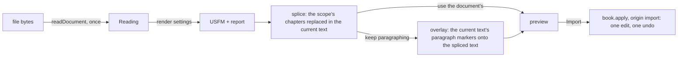

A translator who drafted in Word or LibreOffice brings that draft into a book: a chapter, a range of chapters, or the whole book. The reading is done by the new package `@sefer/document-import` (`packages/document-import`, built 2026-10-29). This plan covers the part inside Sefer: the menu item, the dialog, the preview, and the one undoable edit.

> I would just want this buried in a menu for like import from Word, and then we'd probably want some sort of modal to pop up […] makes them explicitly pick the scope, i.e., the book and or chapters

> if there is an existing text, use our overlay functionality to try to get the paragraph breaks correct, though there should probably be an option for that of keep existing paragraph breaks

## What changes for a translator

1. **Import from Word or LibreOffice…** appears in the command palette and in the book screen's menu.
2. A dialog asks for the file, then shows what was found: chapters and verse counts, missing verses, numbers left as text, tracked changes still in the file.
3. They pick the **scope**: the book, and all of it or some chapters. Typing a citation such as `TIT 2-3` works too. It starts as the focused book and the chapters the document holds.
4. **Keep this book's paragraphing** is ticked when the scope already has text. Unticked, the document's own paragraphs, poetry and headings are used.
5. Switches appear only for what the document actually has: poetry, headings, footnotes, italic, bold, lists, text before verse 1. **Advanced** adds how verse numbers are written, the chapter words, and marker renames.
6. The preview shows the result and updates as they tick. **Import** makes one edit, and one Undo takes it back. Nothing is written to disk until **Record a version**, as for every other edit.

<Mock id="dialog" height={300}>
<div style="font: 13px system-ui; padding: 12px; display: grid; grid-template-columns: 260px 1fr; gap: 12px; color: var(--color-fg, #222)">
  <div style="display: grid; gap: 8px; align-content: start">
    <strong>Import from Word or LibreOffice</strong>
    <div>master-titus.docx · <span style="opacity:.7">46 verses in 3 chapters</span></div>
    <label>Scope <input value="TIT 1-3" style="width: 90px" /></label>
    <label><input type="checkbox" checked /> Keep this book's paragraphing</label>
    <div style="opacity:.7">Found: 1 line before verse 1 · no footnotes · no comments</div>
    <label><input type="checkbox" checked /> Text before verse 1 as \rem</label>
    <details><summary>Advanced</summary>Verse numbers: superscript (detected) · Chapter words: chapter</details>
    <button>Import 3 chapters</button>
  </div>
  <pre style="margin: 0; padding: 8px; background: rgba(0,0,0,.04); overflow: hidden">\c 1
\p
\v 1 Paul, a servant of God and an apostle…
\v 2 in hope of eternal life which God…
\v 3 and at the proper time, revealed his word…
\p
\v 4 To Titus, a true child according to…</pre>
</div>
</Mock>

## How it works

The package reads the file once. Rendering is pure and cheap, so the dialog reruns it on every change of a setting. Sefer then does the three things the package cannot know about: the scope, the existing text, and the edit.

<Mermaid id="flow" caption="From a file to one undoable edit">

</Mermaid>

- **Lazy.** The command's `run` does `await import("@sefer/document-import")`, so neither the package nor `fflate` is in the main bundle. XML is read with the webview's own `DOMParser`; `@xmldom/xmldom` is for Node only, and the package keeps it out of browser builds.
- **Splice** (core, framework-free): the scope's chapters in the current text are replaced by the same-numbered chapters of the rendered USFM. Everything outside the scope is left alone, header included. A book with no text gets the rendered USFM with its own `\id`.
- **Overlay** reuses the galley overlay behind `overlay.*` (`overlayBook` in `src/core/fixes/fixes.ts`). It needs a variant that takes a target *text* instead of a Book, because the target is the spliced text and not yet the book. The current text is the source, and the overlay is limited to paragraph markers and scoped per chapter. Poetry lines the document does not split are left as the overlay leaves them, with empty slots the translator deletes or fills.
- **Apply** is one `book.apply` from the current text to the final text, with origin `"import"`, so Undo and the backup journal treat it like any other edit.

<Source path="src/core/fixes/fixes.ts" lines="126-160" />

<Files id="footprint">
```
+ src/core/documentImport/
+ src/core/documentImport/splice.ts -- replace the scope's chapters; header and other chapters untouched
+ src/core/documentImport/importPreview.ts -- render → splice → (overlay) → FormatPreview-shaped changes; applyImport
~ src/core/fixes/fixes.ts -- overlayText(galley, targetText, sourceText, opts): overlayBook without the Book
+ src/app/ui/import/ImportDocumentDialog.tsx -- file, scope, switches from report.found, Advanced, preview
+ src/app/ui/import/ImportPreview.tsx -- the result in a read-only editor view
+ src/app/ui/primitives/ChapterScope.tsx -- book + chapters, accepts a citation (parseCitation)
~ src/app/commands.ts -- import.document: when hasBook; lazy-loads the package and opens the dialog
~ src/app/messages/en.json -- dialog copy (Paraglide)
~ package.json -- @sefer/document-import: workspace:*
~ documentation/architecture/landing.md -- a "documents into a book" section beside the import sources
~ documentation/services.md -- the import row
```
</Files>

My estimate is 800 to 1,200 lines on the Sefer side. The package is about 1,800.

## Questions

<Question id="trust">An import is a whole-chapter replace that the translator has previewed. Should it be trusted, as `overlay` and `format` are (`trustedBy("import")`), or judged by the keyboard rules like a paste? Trusted is simpler and matches overlay. Judged would refuse an import whose result breaks a rule, and the dialog would then need to say why.</Question>

<Question id="missing">Verses the scope has but the document does not: the import replaces whole chapters, so those verses disappear. That is faithful to the document, and the preview lists them. Is that right, or should there be a "keep verses the document lacks" switch?</Question>

<Question id="offset">A document with no chapter labels reads as chapter 1. If the translator scopes it to chapter 4, should Sefer map the document's chapter 1 to 4 (a "document starts at chapter N" setting), or only ever match chapters by number?</Question>

<Question id="new-book">A scope naming a book the project does not have yet: create the book file from the rendered USFM, or refuse until the book exists? Creating books is where Create stops today ([landing](../../documentation/architecture/landing.md)).</Question>

<Question id="preview">Is the preview the result alone, in a read-only editor view, or the Review screen's verse-aligned comparison of current against result? The comparison is more useful when "Keep this book's paragraphing" is ticked, but it costs more.</Question>

<Question id="where">Where else does the command show up besides the palette: the book screen's toolbar menu, the landing screen's import hub, or both?</Question>

## Follow-ups

<Followup id="versification">Pass a `versification(chapter)` to `render` once one of the canon lists exists as a TypeScript package we can depend on. Until then the sequence rule does the work.</Followup>

<Followup id="bridges-in-editor">The editor's typed verse numbers (`TYPED_VERSE` in `packages/editor/src/core/verseLines.ts`, PR 10) match a single number only. Typing `1-2 ` should give `\v 1-2`. The package already reads bridges.</Followup>

<Followup id="comments">The package returns comment threads anchored by verse and offset. Sefer ignores them until commenting lands.</Followup>

<Followup id="verify-skill" done>A verification skill for the package: one command that checks a change against the fixtures and the rules in its README.</Followup>

<Tradeoff id="grammar" chose="the package keeps its own verse-number grammar" cost="two copies of a short regex to keep in step with the editor">The editor and the package agree on `1`, `1.`, `v1` and `verse 1`. Sharing the code would make the package depend on `@sefer/text`, and it is meant to be able to leave this repository.</Tradeoff>
