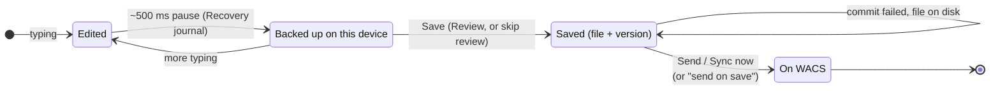
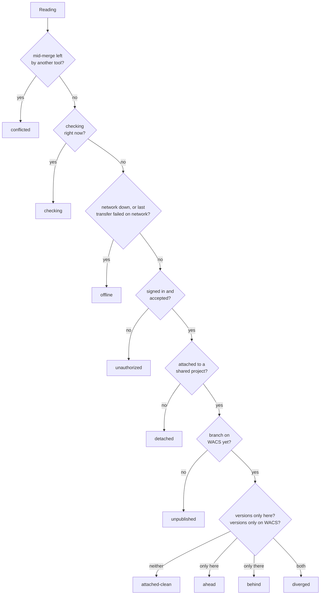
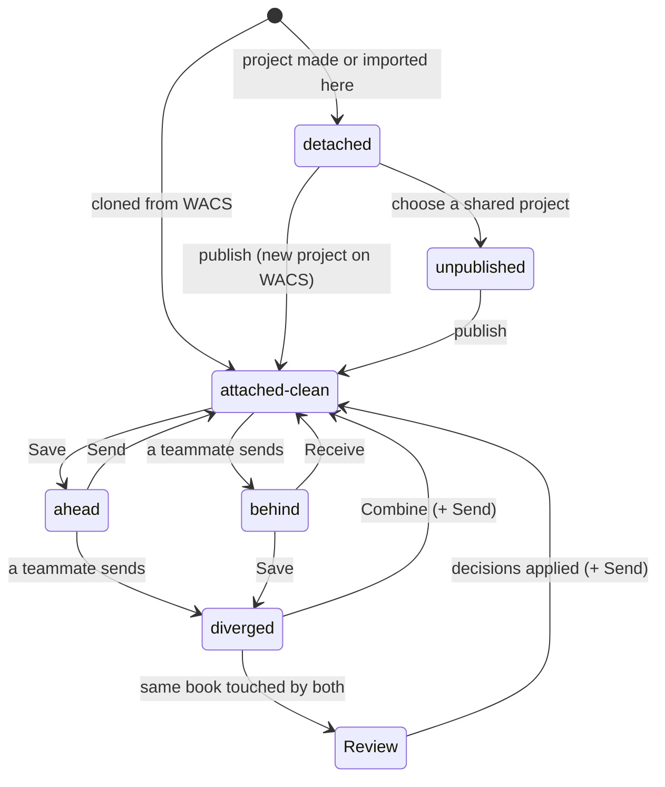
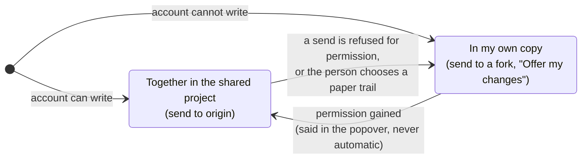

SEFER-92 (REQ-22) and SEFER-83 (REQ-12). The app bar's sync chip (branch `design/sync-chip`)
names every state the code knows. Talking it over with paisano:

> some states may not need to always be explicitly stated. For example, Sefer tracks whether
> you're on a shared repo, but thats only relevant when you want to push content to WACS and
> you're out of date... so it makes sense to expose that information only when its relevant.

His suggestion: draw the whole flow first, then decide what surfaces. These diagrams are the
code as it is today (`src/core/sync/state.ts`, `documentation/architecture/review.md` §4,
`documentation/architecture/sync.md`), not a proposal.

## 1. A piece of work, from typing to WACS

Three layers, each written by something different. Only the first is automatic.

<Mermaid id="work-lifecycle" caption="One edit's life. Solid arrows are automatic; labelled ones are a person's press.">

</Mermaid>

## 2. Where the project stands against WACS

The sync state is a ladder; the first rule that matches wins, so the order is the policy.

<Mermaid id="sync-ladder" caption="syncStateOf: checked top to bottom.">

</Mermaid>

## 3. How the states move

<Mermaid id="sync-transitions" caption="The common paths between states. Offline, checking and unauthorized can interrupt any of them.">

</Mermaid>

## 4. Who it is sent to

Orthogonal to the states above, per project on this device (`CollabMode`).

<Mermaid id="collab-mode" caption="Two ways to work.">

</Mermaid>

## What a translator needs to see, and when

The proposal: the chip answers one question — *is my work safe, and how long since WACS got
it?* Everything else stays quiet until it changes what the person should do.

| Fact | Always on the chip | Only when it matters | Only in the popover |
| --- | --- | --- | --- |
| Work is backed up on this device | | while backing up (subtle) | yes |
| Edits not saved as a version | | Save is highlighted | count of books |
| How long since WACS got the work | yes | | exact time |
| Saves waiting to go up | count badge | amber after N days | yes |
| Offline | yes, calmly | | what still works |
| Signed out | | when there is something to send | Sign in |
| Shared project vs not attached | | when they try to send | choose / publish |
| Behind (teammate sent) | | yes: "Updates on WACS" | who, which books |
| Diverged / contested | | yes: needs attention | Combine or Review |
| Together vs own copy | | when a send is refused | mode switch |
| Checking | | spinner on the icon only | |
| Conflicted (other tool) | | yes: needs attention | Finish the transfer |

<Question id="hide-detached">Is "not attached to a shared project" ever worth saying before the person tries to send? Paisano's view: no.</Question>

<Question id="amber-after">After how many days of unsent saves should the chip turn amber? Field data may settle it.</Question>

<Question id="autosave-signal">What subtle signal shows the backup happening — a brief dot, the icon pulsing, nothing at all?</Question>

<Question id="behind-on-chip">Should "Updates on WACS" (behind) take over the chip, or only badge it? Today it turns the chip amber.</Question>

<Followup id="remove-tweak">Remove the chip's "Sync state" design tweak from `src/app/ui/cloud/SyncButton.tsx` once the states are settled.</Followup>
